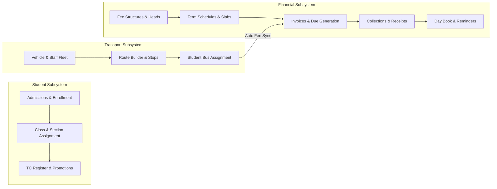

# MyZkool System Architecture

```mermaid
flowchart TD
    Client["Browser SPA (React 19 + Tailwind v4 + Vite)"] -->|HTTP / REST| Express["Express Backend (server.ts / dist/server.cjs)"]
    Client -->|Direct Supabase Client (Anon Key)| Supabase["Supabase (PostgreSQL 15 + RLS + Storage)"]
    Express -->|Gemini Flash SDK| Gemini["Google GenAI API (Gemini 2.5 Flash)"]
    Express -->|Orders & Webhook Verification| Razorpay["Razorpay Payment Gateway"]
    Express -->|Admin Privileged Ops| Supabase
```

---

## 1. Architectural Overview & Tier Organization

MyZkool employs a modern hybrid client-server architecture balancing low-latency client interactivity with strict server-side validation and secure database transactions:

### 1. Presentation Tier (Client SPA)
* **Framework**: React 19.0.1 running under Vite 6.2.3 with Tailwind CSS v4.
* **Routing**: Client-side single-page routing managed by `react-router-dom` v7. Lazy code-splitting ensures that individual module routes (`/admin/students/*`, `/admin/fees/*`, `/admin/transport/*`, `/portal/*`) load on demand as isolated chunk bundles.
* **Component Design**:
  * **Core Primitives**: Themeable buttons, modals, badges, inputs in `src/components/common/` and `src/components/ui/`.
  * **Administrative Shell**: Persistent sidebar, contextual top bar, and role-aware navigation in `src/components/admin/AdminShell.tsx`.
  * **Feature Domain Modules**: Self-contained component trees for Student management, Fee collections, Reminders, and Route planning.
  * **Printing Engines**: Deterministic client-rendered receipt templates (Thermal 80mm and A5 multi-copy formats) and invoice PDF builders.

### 2. Application & Integration Tier (Express Server)
* **Runtime**: Express 4.21.2 compiled to Node.js CommonJS bundle (`dist/server.cjs`) via esbuild.
* **Vite Integration**: Provides seamless Vite SSR dev middleware during local development and static SPA serving in production mode.
* **AI & Document Microservices**:
  * `/api/chat`: Institutional advisor powered by `@google/genai` (Gemini 2.5 Flash) with school context injection.
  * `/api/ai/analyze-document`: Multimodal OCR processing student admission forms, previous school transfer certificates, and Aadhaar cards.
  * `/api/ai/tts`: Native Hindi and English audio generation for parent payment instructions and notifications.
* **Payment Processing**:
  * `/api/razorpay/create-order`: Cryptographically calculated server-side order amounts ensuring zero frontend tampering.
  * `/api/razorpay/verify-payment`: Secure HMAC-SHA256 signature verification over payment signatures before collection commitment.
* **Compliance & Data Privacy**:
  * `/api/deletion`: DPDP-compliant data purging pipeline requiring verified school administrator JWT credentials.

### 3. Data & Tenancy Tier (Supabase PostgreSQL)
* **Multi-Tenancy Model**: Unified database schema with row-level logical separation enforcing composite foreign keys `(school_id, parent_id)`.
* **Row Level Security (RLS)**: Enforced across all tables. Functions `public.get_current_school_id()`, `public.is_school_member(school_id)`, and `public.is_school_admin(school_id)` inspect `public.profiles` linked to `auth.uid()`.
* **Composite Foreign Keys**: Hardened via migration `022_multi_tenant_isolation_hardening.sql`. Prevents cross-tenant parent-child references.
* **Data at Rest Protection**: DPDP Act compliance through AES-256-GCM field encryption (`APP_MASTER_KEY`) for Aadhaar and guardian financial details.

---

## 2. Core Subsystems



### 1. Student Management Subsystem
* Tracks admissions through a multi-step enrollment pipeline.
* Supports batch student CSV/Excel imports with rollback validation (`rpc_bulk_import_students`).
* Handles academic year promotions and historical Transfer Certificate (TC) records.

### 2. Fee & Ledger Subsystem
* Configurable fee structures by class and academic year.
* Concession rules, sibling discounts, and automated late fee penalty calculators.
* Real-time ledger accounting with partial payments, cheque clearance tracking, and cash day-close reconciliation.

### 3. Transport Management Subsystem
* Route optimization with ordered stops and distance/slab-based pricing.
* Vehicle compliance tracking (fitness certificates, insurance expiration, driver license tracking).
* Automated bidirectional sync between transport enrollment and student fee invoices.

