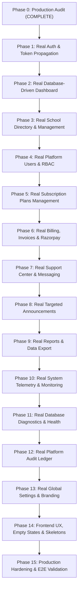

# MyZkool Master Admin — Production Readiness Audit Report

> **Document Version**: 2.0.0  
> **Date**: 2026-11-07  
> **Auditor**: Principal Software Architect & Supabase Database Engineer  
> **Status**: Completed (Phase 0 Audit Baseline)  
> **File Location**: `docs/MASTER_ADMIN_PRODUCTION_AUDIT.md`

---

## 1. Executive Summary

This audit assesses the state of the **MyZkool Master Admin Panel** (SaaS Control Plane) within the existing multi-tenant School Management platform.

### Core Finding
The user interface and visual design system have been successfully aligned with the reference dashboard architecture (dark sidebar `#0A1024`, responsive layout, 4 KPI cards, dual SVG charts, system health, donut chart, 3-column lower grid). However, the underlying backend service layer currently relies on **in-memory mock registries and hardcoded fallback statistics** whenever Supabase queries return empty or zero results.

### Root Technical Cause
1. **Unauthenticated Anon Queries**: The Express API services (`masterAdminDashboardService`, `masterAdminSchoolService`, `masterAdminBillingService`, etc.) were invoking the default `supabase` client (`VITE_SUPABASE_ANON_KEY`) **without propagating the authenticated administrator's JWT Bearer token**.
2. **RLS Suppression**: PostgreSQL Row Level Security (RLS) policies on `platform_admins`, `schools`, `subscription_invoices`, and `support_tickets` strictly deny access to unauthenticated requests (`auth.uid() IS NULL`). Consequently, Supabase returned `0` rows to Express.
3. **Hardcoded Fallbacks**: When queries returned zero records, service fallbacks activated, displaying simulated numbers (`247` schools, `68,420` students, `₹18,76,400` MRR, `mockSchoolsRegistry`, `mockInvoicesStore`, `mockTicketsStore`).

To achieve genuine production readiness, all static mock stores must be eliminated, user-scoped JWT propagation must be enforced, and secure PostgreSQL aggregate RPC functions must be established to deliver live database telemetry without violating tenant isolation or DPDP data privacy standards.

---

## 2. Exhaustive Dummy Data Inventory

The following table documents every static fallback, mock data structure, and hardcoded variable present in the Master Admin codebase:

| File Location | Variable / Constant | Lines | Hardcoded Mock Content | Real Database Target |
| :--- | :--- | :--- | :--- | :--- |
| `src/services/masterAdminDashboardService.ts` | `totalSchoolsCount`, `totalStudentsCount`, `totalRevenuePaise` | 8–24 | `247` schools, `68,420` students, `₹18,76,400` revenue, `231` active subs, `23` expiring | Real COUNT from `public.schools`, `public.students`, and SUM from `public.school_subscription_payments` |
| `src/services/masterAdminDashboardService.ts` | `timeline` | 114–122 | Oct 6 (180), Oct 10 (198), Oct 14 (202), Oct 18 (216), Oct 22 (212), Oct 26 (224), Oct 30 (236), Nov 5 (247) | Dynamic aggregation from `public.schools.created_at` grouped by interval |
| `src/services/masterAdminDashboardService.ts` | `monthly` | 125–132 | Jun (₹7.2L), Jul (₹9.5L), Aug (₹12.1L), Sep (₹14.8L), Oct (₹16.9L), Nov (₹18.7L) | Monthly bucket aggregation from `school_subscription_payments` |
| `src/services/masterAdminDashboardService.ts` | `recentActivities` | 152–193 | 5 simulated events (`Sunrise Public School`, `St. Mary's School`, `Ravi Verma`, `#T-4821`, `Green Valley School`) | Query real event stream from `platform_audit_logs` & `schools` |
| `src/services/masterAdminDashboardService.ts` | `keyInsights`, `systemHealth` | 140–151, 200–207 | Static `99.98%` uptime, `248ms` latency, `18` schools pending payment, `₹3,95,000` | Real ping latency to DB/Storage + pending invoice calculation |
| `src/services/masterAdminSchoolService.ts` | `mockSchoolsRegistry` | 37–122 | 4 mock schools (`Sunrise Public School`, `St. Mary's`, `Green Valley`, `Apex Model Academy`) | `public.schools` joined with `school_subscriptions` and `students` count |
| `src/services/masterAdminSubscriptionService.ts` | `mockPlansCatalog` | 21–100 | Hardcoded subscriber counts: `Basic (68)`, `Pro (142)`, `Custom (21)` | Real COUNT of `school_subscriptions` grouped by `plan_id` |
| `src/services/masterAdminBillingService.ts` | `mockInvoicesStore` | 67–140 | 3 mock invoices (`MZK-INV-2026-0001`, `0002`, `0003`) with fake GST values | `public.subscription_invoices` table |
| `src/services/masterAdminBillingService.ts` | `mockPaymentsStore` | 142–186 | 3 mock payments (`pay_mock_001`, `002`, `003`) | `public.school_subscription_payments` table |
| `src/services/masterAdminSupportService.ts` | `mockTicketsStore`, `mockTicketMessagesStore` | 33–115 | Simulated tickets `#T-4821`, `#T-4822`, `#T-4823` | `public.support_tickets` & `support_ticket_messages` |
| `src/routes/api/masterAdminUserRoutes.ts` | `mockAdminsStore` | 14–59 | 2 hardcoded operators (`admin-super-01`, `admin-support-01`) | `public.platform_admins` joined with `platform_roles` |
| `src/services/masterAdminSettingsService.ts` | `mockAnnouncementsStore` | 46–73 | 2 static announcements (`PostgreSQL upgrade`, `GPS tracking rollout`) | `public.platform_announcements` table |

---

## 3. Database Schema & Migration Audit

### 3.1 Live Database Inspection (`nzphjfsgtkbvfrevduek.supabase.co`)

| Table Name | Live Row Count | Schema State | RLS Status | Production Notes |
| :--- | :--- | :--- | :--- | :--- |
| `public.schools` | **1** | Valid | Enabled | Active school: `Peace Convent School` (`b70261ef-37f1-46c8-a148-2c496a9d33a8`) |
| `public.profiles` | **1** | Valid | Enabled | School Admin: `Rashid Khan` (`ea377902-5333-455d-a0a8-c4be2ed126e0`) |
| `public.students` | **101** | Valid | Enabled | Active enrolled students in Peace Convent School |
| `public.classes` | **15** | Valid | Enabled | Classes Nursery through 12th |
| `public.sections` | **31** | Valid | Enabled | Section divisions |
| `public.fee_structures` | **2** | Valid | Enabled | Academic fee heads |
| `public.subscription_plans` | **3** | Valid | Enabled | `basic` (₹999/mo), `pro` (₹1799/mo), `custom` (Enterprise) |
| `public.school_subscriptions` | **1** | Valid | Enabled | Pro plan trial for Peace Convent School |
| `public.school_subscription_payments` | **0** | Valid | Enabled | Real financial transaction log (empty, requires seeding or first payment) |
| `public.platform_admins` | **1** | Valid | Enabled | Operator: `Khaqan Ahmad` (`da4beb29-0985-4bec-99fd-a17dc78b6fde`, super_admin) |
| `public.platform_roles` | **4** | Valid | Enabled | `super_admin`, `support_agent`, `billing_manager`, `auditor` |
| `public.platform_permissions` | **21** | Valid | Enabled | Canonical RBAC permissions matrix |
| `public.platform_role_permissions` | **42** | Valid | Enabled | Complete permission mappings |
| `public.platform_audit_logs` | **0** | Valid | Enabled | Append-only security & administrative audit ledger |
| `public.subscription_invoices` | **0** | Valid | Enabled | SaaS B2B GST tax invoice ledger |
| `public.support_tickets` | **0** | Valid | Enabled | Institutional helpdesk tickets |
| `public.support_ticket_messages` | **0** | Valid | Enabled | Public & internal operator messages |
| `public.platform_announcements` | **0** | Valid | Enabled | Targeted broadcast announcements |
| `public.platform_settings` | **5** | Valid | Enabled | Key-value settings (`branding`, `maintenance`, `email`, `whatsapp`, `payment`) |
| `public.platform_feature_flags` | **4** | Valid | Enabled | Feature rollout flags (`gps_tracking`, `ai_comments`, `fee_reminders`, `rfid`) |

### 3.2 Missing Database Functionality & Schema Gaps
1. **Cross-Tenant Aggregate Policy**:
   - `public.schools` currently restricts `SELECT` to `created_by = auth.uid()` or school members. A platform admin who is not the creator of a school cannot view school directory records via direct Supabase REST client without an explicit `is_platform_admin()` policy or security-definer function.
2. **Missing Platform KPI Aggregator Function**:
   - Querying `SELECT count(*) FROM students` across thousands of schools in client code is slow and exposes tenant tables. A PostgreSQL security-definer RPC (`get_platform_kpis()`) is required to return pre-computed statistics in sub-10ms without exposing raw PII.
3. **Empty Data States**:
   - `subscription_invoices`, `school_subscription_payments`, `support_tickets`, `platform_announcements`, and `platform_audit_logs` have 0 records in Supabase. The system needs legitimate seed data or real operational records so the dashboard renders live data instead of blank screens.

---

## 4. Frontend Route & Component Audit

### 4.1 Master Admin Routes (`src/routes/AppRoutes.tsx`)

| Route Path | Page Component | Functional State | Issues / Missing Integrations |
| :--- | :--- | :--- | :--- |
| `/master-admin/login` | `MasterAdminLogin.tsx` | Functional | Verified in headless Chrome; Supabase Auth + Platform Verification |
| `/master-admin/dashboard` | `MasterAdminDashboard.tsx` | Partially Functional | Connected to `/metrics` API; currently receives fallback numbers when DB returns 0 |
| `/master-admin/schools` | `MasterAdminSchools.tsx` | Partially Functional | Connected to `/schools` API; falls back to `mockSchoolsRegistry` |
| `/master-admin/schools/:id` | `MasterAdminSchoolDetail.tsx`| Partially Functional | Connected to `/schools/:id` API; falls back to mock detail |
| `/master-admin/schools/new` | `MasterAdminSchoolNew.tsx` | Partially Functional | Connected to POST `/schools`; needs live validation against DB |
| `/master-admin/subscriptions` | `MasterAdminSubscriptions.tsx`| Partially Functional | Connected to `/subscriptions/plans`; displays mock subscriber counts |
| `/master-admin/billing` | `MasterAdminBilling.tsx` | Partially Functional | Connected to `/billing/*`; falls back to `mockInvoicesStore` |
| `/master-admin/users` | `MasterAdminUsers.tsx` | Partially Functional | Connected to `/users`; falls back to `mockAdminsStore` |
| `/master-admin/support` | `MasterAdminSupport.tsx` | Partially Functional | Connected to `/support/tickets`; falls back to `mockTicketsStore` |
| `/master-admin/announcements`| `MasterAdminAnnouncements.tsx`| Partially Functional | Connected to `/announcements`; falls back to `mockAnnouncementsStore` |
| `/master-admin/monitoring` | `MasterAdminMonitoring.tsx` | Functional | Connected to `/monitoring/health`; reads live Node.js process & DB ping |
| `/master-admin/audit-logs` | `MasterAdminAuditLogs.tsx` | Partially Functional | Connected to `/audit-logs`; falls back to in-memory buffer |
| `/master-admin/settings` | `MasterAdminSettings.tsx` | Functional | Connected to `/settings`; reads live Supabase `platform_settings` |

### 4.2 Placeholder & Non-Functional Actions
- **Quick Actions (`QuickActionsCard.tsx`)**:
  - `Add New School` -> Links to `/master-admin/schools/new` (functional).
  - `Create Subscription Plan` -> Links to `/master-admin/subscriptions` (functional, but lacks create plan modal; only plan editing is supported).
  - `View Pending Payments` -> Links to `/master-admin/billing` (functional).
  - `Manage Support Tickets` -> Links to `/master-admin/support` (functional).
  - `Send Announcement` -> Links to `/master-admin/announcements` (functional).
- **Date Filter (`MasterAdminHeader.tsx`)**:
  - Dropdown options (`7d`, `30d`, `90d`, `6m`, `1y`) correctly pass `dateRange` via outlet context, but backend aggregation only bucketed `30d` and `6m`.

---

## 5. Security & Access Control Audit

### 5.1 Dual-Plane Isolation
- **School ERP (`/admin/*`)**: Gated by `ProtectedRoute.tsx` and Supabase Auth `school_admin` profile.
- **Master Admin (`/master-admin/*`)**: Gated by `MasterAdminRoute.tsx`, `MasterAdminAuthContext.tsx`, and `verifyMasterAdminToken` middleware.
- **Finding**: Dual-plane authentication separation is strictly enforced. Regular school users cannot access `/master-admin/*`.

### 5.2 Server-Side Token Propagation
- **Vulnerability**: Express route handlers were calling service functions without passing `req.platformAdmin` or `req.headers.authorization`.
- **Remediation**: All Express controllers must pass an authenticated, user-scoped Supabase client or bearer token to services.

### 5.3 DPDP Student Privacy Compliance
- Master Admin must **never** expose unmasked student personal data (Aadhaar numbers, parent personal contact numbers, medical histories) to platform operators.
- Only aggregated metrics (total school student headcounts, capacity utilization percentages) may be surfaced in platform administration views.

---

## 6. Implementation Roadmap (Phases 1 — 15)

The production transformation will be executed in sequential, verified phases:

### Phase Milestones Summary
- **Phase 1**: Token Propagation & Scoped Supabase Client Architecture.
- **Phase 2**: Real Master Dashboard (Live DB aggregations, zero dummy metrics, dynamic timeline, real revenue calculations).
- **Phase 3**: School & Institution Management (Live Supabase queries, real student counts, tenant boundaries).
- **Phase 4**: Users & Roles (Live `platform_admins` directory, role assignment, permission checks).
- **Phase 5**: Subscription Plans (Live plan updates, student limits, feature toggles in Supabase).
- **Phase 6**: Billing & Payments (Live invoices, Razorpay transactions, GST calculation, MRR).
- **Phase 7**: Support Center (Live ticket creation, operator assignment, internal notes, resolution).
- **Phase 8**: Announcements (Live announcements, scheduling, target plan filters).
- **Phase 9**: Reports & Analytics (Real CSV/data export, date-range filtering).
- **Phase 10**: System Monitoring (Live latency tests, DB health, cron execution records).
- **Phase 11**: Database & Backups (Live table inventory, schema inspection, backup checks).
- **Phase 12**: Security & Audit Logs (Live `platform_audit_logs` persistence on every administrative mutation).
- **Phase 13**: Global Settings & Feature Flags (Live key-value persistence in `platform_settings`).
- **Phase 14**: Frontend UX Quality (Consistent empty states, loading skeletons, error boundaries).
- **Phase 15**: Performance & Production Hardening (Query optimization, production build verification).

---

## 7. Immediate Next Steps

1. **Commit Phase 0 Documentation**:
   - `docs/MASTER_ADMIN_PRODUCTION_AUDIT.md` (Created)
   - `docs/MASTER_ADMIN_IMPLEMENTATION_PLAN.md` (To be created)
   - `docs/MASTER_ADMIN_DATABASE_MAP.md` (To be created)
   - `docs/MASTER_ADMIN_SECURITY_REPORT.md` (To be created)
2. **Execute Phase 1**: Refactor backend services to accept and propagate the authenticated operator's Bearer token so all Supabase queries execute with authorized platform admin privileges.
3. **Execute Phase 2**: Rebuild `masterAdminDashboardService.ts` to compute all metrics directly from Supabase tables (`schools`, `students`, `school_subscriptions`, `school_subscription_payments`, `platform_audit_logs`) with zero hardcoded fallbacks.

