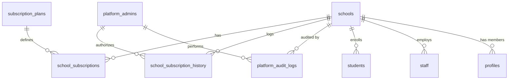

# MYZKOOL — SCHOOLS & INSTITUTIONS
## Database Schema, Relationships & Data Model Documentation

**Document:** `docs/SCHOOLS_INSTITUTIONS_DATABASE.md`  
**Database:** PostgreSQL 17.6 (Supabase)  
**Status:** Verified & Active

---

## 1. Entity-Relationship Overview

---

## 2. Table Specifications

### 2.1 `public.schools` (Core Educational Institution Entity)
| Column | Type | Constraints | Description |
| :--- | :--- | :--- | :--- |
| `id` | UUID | PRIMARY KEY | Unique tenant identifier |
| `name` | TEXT | NOT NULL | School display name |
| `subdomain` | TEXT | UNIQUE, NOT NULL | Isolated tenant portal slug |
| `institution_code` | TEXT | UNIQUE | Human-readable code (e.g. `MYZ-00124`) |
| `school_type` | TEXT | NOT NULL DEFAULT 'k12' | K-12, Senior Secondary, etc. |
| `affiliation_board` | TEXT | DEFAULT 'cbse' | CBSE, ICSE, State Board |
| `official_email` | TEXT | NOT NULL | Primary institutional contact email |
| `contact_phone` | TEXT | NOT NULL | Official contact phone |
| `address` | TEXT | | Street address |
| `city` | TEXT | NOT NULL | City location |
| `district` | TEXT | | District location |
| `state` | TEXT | NOT NULL | State location |
| `pin_code` | TEXT | NOT NULL | Postal pin code |
| `status` | TEXT | NOT NULL DEFAULT 'active' | `'active' \| 'suspended' \| 'pending'` |
| `suspended_at` | TIMESTAMPTZ | | Timestamp when suspended |
| `suspension_reason`| TEXT | | Mandatory operational reason |
| `suspended_by` | UUID | FK -> `platform_admins.id` | Operator who suspended tenant |
| `storage_limit_bytes`| BIGINT | DEFAULT 53687091200 | Maximum storage allocation (50 GB) |
| `storage_used_bytes` | BIGINT | DEFAULT 0 | Actual storage consumed |
| `principal_name` | TEXT | | Principal or owner name |
| `principal_email`| TEXT | | Principal contact email |
| `onboarding_completed` | BOOLEAN | DEFAULT FALSE | Onboarding completion flag |
| `onboarding_step` | INT | DEFAULT 1 | Current step in 8-stage pipeline |
| `logo_url` | TEXT | | URL to school emblem in storage |
| `created_at` | TIMESTAMPTZ | DEFAULT now() | Registration timestamp |
| `updated_at` | TIMESTAMPTZ | DEFAULT now() | Last update timestamp |

### 2.2 `public.school_subscriptions` (Subscription Status & Period)
| Column | Type | Constraints | Description |
| :--- | :--- | :--- | :--- |
| `id` | UUID | PRIMARY KEY | Subscription record UUID |
| `school_id` | UUID | NOT NULL, FK -> `schools.id` | Associated institution |
| `plan_id` | UUID | NOT NULL, FK -> `subscription_plans.id` | Plan catalog reference |
| `billing_cycle` | TEXT | NOT NULL DEFAULT 'yearly' | `'monthly' \| 'six_months' \| 'yearly'` |
| `status` | TEXT | NOT NULL DEFAULT 'trialing' | `'trialing' \| 'active' \| 'past_due' \| 'cancelled' \| 'expired'` |
| `trial_starts_at` | TIMESTAMPTZ | | Trial commencement date |
| `trial_ends_at` | TIMESTAMPTZ | | Trial conclusion date |
| `current_period_starts_at`| TIMESTAMPTZ | | Current billing period start |
| `current_period_ends_at` | TIMESTAMPTZ | NOT NULL | Subscription validity end date |
| `payment_status` | TEXT | NOT NULL DEFAULT 'trial' | `'trial' \| 'paid' \| 'pending' \| 'failed'` |
| `amount` | NUMERIC | | Plan amount in INR |
| `metadata` | JSONB | DEFAULT '{}' | Custom plan parameters |

### 2.3 `public.school_subscription_history` (Audit & Lifecycle Ledger)
| Column | Type | Constraints | Description |
| :--- | :--- | :--- | :--- |
| `id` | UUID | PRIMARY KEY | Unique history entry UUID |
| `school_id` | UUID | NOT NULL, FK -> `schools.id` | Target school |
| `subscription_id`| UUID | FK -> `school_subscriptions.id` | Active subscription at event time |
| `operation_type` | TEXT | NOT NULL | `'plan_change' \| 'trial_extended' \| 'validity_extended' \| 'status_change' \| 'complimentary_grant'` |
| `previous_plan_slug`| TEXT | | Slug before operation |
| `new_plan_slug` | TEXT | | Slug after operation |
| `previous_expiry`| TIMESTAMPTZ | | Expiry before operation |
| `new_expiry` | TIMESTAMPTZ | | Expiry after operation |
| `classification`| TEXT | NOT NULL DEFAULT 'paid' | `'paid' \| 'complimentary' \| 'trial' \| 'system'` |
| `reason` | TEXT | NOT NULL | Mandatory administrative justification |
| `payment_reference`| TEXT | | Wire UTR, invoice receipt ID, etc. |
| `performed_by` | UUID | FK -> `platform_admins.id` | Authorizing administrator ID |
| `admin_email` | TEXT | NOT NULL | Authorizing administrator email |
| `metadata` | JSONB | DEFAULT '{}' | Event details |
| `created_at` | TIMESTAMPTZ | DEFAULT now() | Immutable event timestamp |

### 2.4 `public.subscription_plans` (Global Plan Catalog)
| Column | Type | Constraints | Description |
| :--- | :--- | :--- | :--- |
| `id` | UUID | PRIMARY KEY | Unique plan UUID |
| `slug` | TEXT | UNIQUE, NOT NULL | `'basic' \| 'pro' \| 'custom'` |
| `name` | TEXT | NOT NULL | Plan name (`Basic Plan`, `Pro Plan`, `Custom Plan`) |
| `price_monthly` | NUMERIC | | Monthly price (INR) |
| `price_yearly` | NUMERIC | | Yearly price with discount (INR) |
| `max_students` | INT | | Student capacity limit |
| `trial_days` | INT | DEFAULT 14 | Default trial duration |
| `features` | JSONB | NOT NULL DEFAULT '[]' | Array of enabled module keys |
| `is_active` | BOOLEAN | DEFAULT TRUE | Active in catalog |

---

## 3. Database Indexes

To ensure sub-millisecond query performance during search and aggregation:
1. `idx_schools_institution_code`: Unique index on `public.schools (institution_code) WHERE institution_code IS NOT NULL`.
2. `idx_schools_status`: Index on `public.schools (status)`.
3. `idx_schools_subdomain`: Unique index on `public.schools (subdomain)`.
4. `idx_sub_history_school`: B-Tree index on `public.school_subscription_history (school_id, created_at DESC)`.
5. `idx_sub_history_operation`: B-Tree index on `public.school_subscription_history (operation_type)`.
6. `idx_school_subscriptions_school`: B-Tree index on `public.school_subscriptions (school_id)`.
