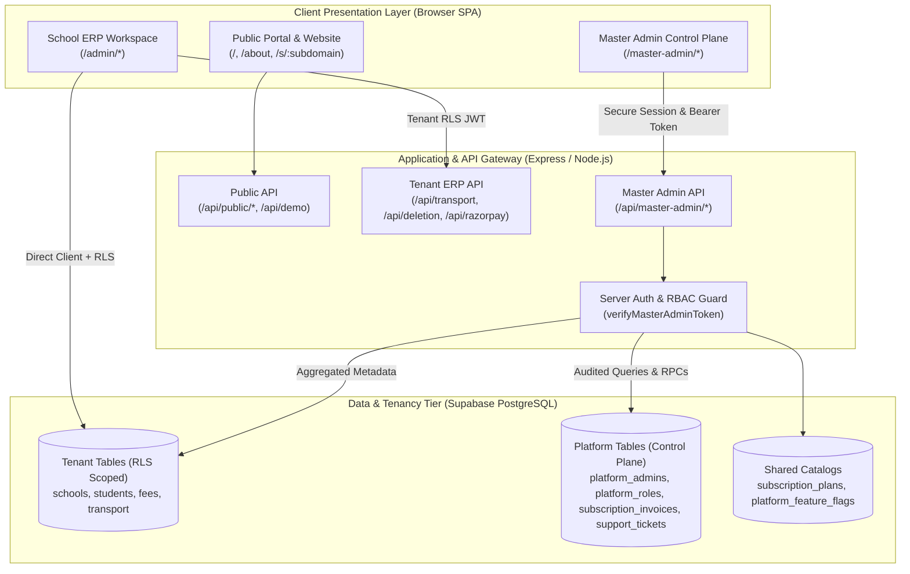
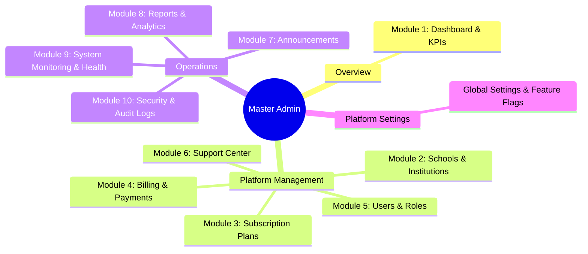

# MyZkool Master Admin — System Architecture Specification

> **Document Version**: 1.0.0  
> **Classification**: Core Architectural Blueprint  
> **Target Audience**: Platform Architects, Security Engineers, Full-Stack Developers  

---

## 1. Architectural Philosophy & Separation of Concerns

MyZkool is structured as a **Dual-Plane Multi-Tenant SaaS**:
1. **Tenant Data Plane (School ERP)**: Operating under `/admin/*`, scoped to individual school tenancies (`school_id`). School principals, accountants, teachers, and admins manage day-to-day operations (students, fees, attendance, bus routes).
2. **Platform Control Plane (Master Admin)**: Operating under `/master-admin/*`, serving as the central SaaS cockpit. Master administrators oversee institutional onboarding, manage subscription tiers, monitor MRR, handle cross-platform support tickets, audit system health, and adjust global feature flags.



---

## 2. Technology Architecture Matrix

The architecture preserves 100% of the existing production stack without introducing conflicting libraries or unnecessary abstraction layers:

| Layer | Selected Technology | Architecture Role |
| :--- | :--- | :--- |
| **Frontend Framework** | React 19.0.1 | Modern concurrent UI rendering, optimistic updates, Suspense |
| **Client Bundler** | Vite 6.2.3 | Instant HMR in dev, isolated chunk splitting in production |
| **Styling & Theme** | Tailwind CSS v4.1.14 | Modern CSS design tokens, custom blue palette (`#2158E0`), dark sidebar (`#0F172A`) |
| **Client Routing** | React Router DOM v7.18.3 | Nested route hierarchy with independent Master Admin shell and route guards |
| **Backend Framework** | Express 4.21.2 | Lightweight Node.js server handling privileged platform APIs, webhooks, and metric aggregations |
| **Primary Database** | Supabase PostgreSQL 15 | Relational integrity, foreign key cascades, RLS security, pg_crypto |
| **Authentication** | Supabase Auth (GoTrue) | Cryptographic JWT issuing, email verification, password resets, session refresh |
| **Authorization** | Dual-Tier RBAC + RLS | Fine-grained platform permissions for Master Admins; strict `school_id` RLS for tenant users |
| **Background Processing** | Express Cron / Edge Functions | Daily invoice generation, subscription expiry sweeps, webhook retries |
| **Payment Gateway** | Razorpay Node SDK | Multi-mode Indian payments (UPI, Cards, NetBanking) with HMAC-SHA256 verification |

---

## 3. The 10 Master Admin Modules

The Master Admin Panel is decomposed into 10 decoupled, high-cohesion operational modules:



---

### Module 1: Dashboard & Real-Time Analytics
* **Purpose**: Provide the executive leadership with a high-level operational pulse of the entire SaaS platform.
* **Core Capabilities**:
  * **Top Metric Cards**:
    * Total Schools (count, active vs suspended, 30-day percentage trend).
    * Total Students (real-time platform-wide aggregate count across all active schools).
    * Monthly Recurring Revenue (MRR in integer paise / formatted INR, 30-day growth).
    * Active Subscriptions (count, percentage of paying tenants vs trials).
  * **Interactive Visualizations**:
    * School Registrations timeline (area chart displaying cumulative and monthly new tenant acquisitions).
    * Subscription Revenue trend (bar chart analyzing last 6 months billing volume).
    * Subscription Plan Distribution (donut chart: Pro, Basic, Custom, Trial ratios).
  * **System Health Widget**:
    * Live operational indicators: Application Web App, Supabase Database, Cloud Storage, Background Cron Workers, API Gateway.
    * 30-day platform uptime percentage (e.g. 99.98%) and average API response latency (e.g. 248 ms).
  * **Activity & Action Feeds**:
    * Real-time platform event stream (school registrations, plan upgrades, admin changes, ticket resolutions).
    * Quick Action shortcuts (Add New School, Create Plan, View Pending Payments, Dispatch Announcement).
    * Urgent Attention panel (expiring subscriptions within 7 days, failed payments requiring retry, unassigned support tickets).

---

### Module 2: School & Institution Management
* **Purpose**: Complete institutional lifecycle control from onboarding through long-term tenancy or suspension.
* **Core Capabilities**:
  * **Institutional Directory**: Searchable, filterable list of all onboarded schools (filter by State, Board, Status: Active/Suspended/Trial/Pending Approval).
  * **School Profile & Metadata**: Institutional legal name, subdomain (`*.myzkool.in`), board affiliation (CBSE, ICSE, State Board), principal/trustee contacts, official email and phone.
  * **Tenant Status Control**: Instant Toggle between `active`, `suspended`, `maintenance`, and `archived` states with mandatory audit justification.
  * **Operational Metrics per School**: Aggregate student headcount, active staff count, assigned bus routes, and fee collection volume.
  * **Onboarding Inspection**: Step-by-step progress inspector for schools in onboarding (School Profile -> Academics -> Classes -> Subscriptions -> Website).

---

### Module 3: Subscription & Entitlement Management
* **Purpose**: Manage the SaaS product catalog, tiers, quotas, and feature entitlements.
* **Core Capabilities**:
  * **Plan Catalog Administration**: Create, modify, and retire plans (`Basic`, `Pro`, `Custom`).
  * **Dynamic Pricing Engine**: Set monthly, 6-month (prepay discount), and annual rates with GST rules (18%).
  * **Hard Resource Quotas**: Configurable ceilings for maximum students, maximum staff, and document storage allocation.
  * **Feature Entitlements**: Enable/disable module gates (e.g., Transport Tracking, AI Document OCR, WhatsApp Automated Alerts, Custom Domains).
  * **Tenant Subscription Overrides**: Ability to grant custom grace periods, extend trials, or adjust quotas for enterprise/pilot institutions.

---

### Module 4: Billing, Invoicing & Financial Operations
* **Purpose**: Centralized billing ledger for SaaS revenue, keeping platform subscription payments strictly isolated from tenant student fee transactions.
* **Core Capabilities**:
  * **Subscription Invoices**: Automated invoice generation upon successful payment or enterprise agreement creation.
  * **Payment Ledger**: Complete transaction history with Razorpay Order ID, Payment ID, Bank reference, and status (`captured`, `failed`, `refunded`).
  * **Failed Payment Recovery**: Tracking unpaid invoices, past-due subscriptions, and automated dunning/retry notifications.
  * **GST Compliance & Invoicing**: Automated calculation of CGST (9%) + SGST (9%) or IGST (18%), SAC code assignment, and downloadable tax invoices.
  * **Refund Processing**: Audited platform subscription refund initiation with reason capture and transaction reversal ledger.

---

### Module 5: User & Access Management (Platform RBAC)
* **Purpose**: Manage platform-level administrators, support operators, and monitor institutional user accounts.
* **Core Capabilities**:
  * **Master Admin User Directory**: Provisioning platform administrators with least-privilege role assignment (`Super Admin`, `Support Specialist`, `Billing Manager`, `Read-Only Auditor`).
  * **Platform Permissions Engine**: Fine-grained capability checks (`schools.manage`, `subscriptions.edit`, `billing.view`, `support.reply`, `audit.view`).
  * **School Owner Directory**: High-level directory of school owners and super-admins across all tenants with account status and last login timestamps.
  * **Active Session Management**: View active administrative sessions and force session revocation for compromised credentials.

---

### Module 6: Support Center & Helpdesk
* **Purpose**: In-app ticketing and resolution hub connecting school staff with MyZkool platform support.
* **Core Capabilities**:
  * **Ticket Ingestion**: Support requests, bug reports, and setup questions submitted by school administrators.
  * **Triage & Assignment**: Priority scoring (`Low`, `Medium`, `High`, `Critical`), module categorization (Fees, Transport, Academics, Login), and agent assignment.
  * **Ticket Threading & Internal Notes**: Public replies sent to school administrators and private internal discussion notes between platform agents.
  * **SLA Tracking**: Resolution time tracking and overdue escalation flags.

---

### Module 7: Platform Communication & Announcements
* **Purpose**: Broadcast maintenance notices, product updates, and administrative reminders across tenants.
* **Core Capabilities**:
  * **Platform Announcements**: Compose global alerts displayed in School Admin ERP banner or modal.
  * **Targeted Delivery**: Broadcast to all schools, specific subscription tiers (e.g. Pro only), or selected states/boards.
  * **Communication Channels**: In-app notification bell, banner notice, automated WhatsApp delivery integration, and email broadcasts.
  * **Notification Templates**: Pre-configured templates for subscription renewal reminders, planned server maintenance, and compliance updates.

---

### Module 8: System Monitoring & Infrastructure Health
* **Purpose**: Proactive operational observability across services, storage, and background workers.
* **Core Capabilities**:
  * **Service Heartbeat**: Real-time health polling of Supabase PostgreSQL, Storage buckets, Express API routes, and Auth endpoints.
  * **Cron & Background Job Status**: Health of late fee automation, transport expiry jobs, and daily ledger reconciliations.
  * **Storage Quota Analytics**: Tracking storage asset utilization (student photos, transfer certificates, receipts) per school.
  * **Error Logs Stream**: Aggregated system exception stream with stack traces, frequency counts, and severity levels.

---

### Module 9: Security Governance & Audit Logging
* **Purpose**: Tamper-evident accountability for every administrative action taken on the SaaS platform.
* **Core Capabilities**:
  * **Immutable Platform Audit Trail**: Append-only log recording actor (`platform_admin_id`), action type, target entity, IP address, and before/after JSON diffs.
  * **Security Alert Monitoring**: Detection of abnormal activities: multiple failed login attempts, bulk export attempts, or rapid school status alterations.
  * **Sensitive PII Access Log**: Dedicated audit record whenever a support agent is granted temporary read access to a school's operational data.

---

### Module 10: Global Settings & Feature Flags
* **Purpose**: Dynamic platform-wide configurations without requiring code redeployments.
* **Core Capabilities**:
  * **Platform Branding & Identity**: Default platform URLs, customer support contact information, portal metadata.
  * **Integration Secrets Management**: Razorpay platform API keys, WhatsApp gateway endpoints, SMS service provider parameters.
  * **Global Feature Toggles**: Staged rollout flags for new ERP modules (e.g., AI Exam Grading, Advanced Biometrics, Bus Telematics).
  * **Platform Maintenance Mode**: Emergency read-only toggle with customizable banner messages for scheduled downtime.

---

## 4. Route Hierarchy & Navigation Architecture

The Master Admin routes are strictly separated from existing application routes:

```
/                                   -> Public Landing Page
/about                              -> Public About Us Page
/s/:subdomain                       -> Public School Website
/pay/:token                         -> Public Parent Payment Link
/login                              -> School Admin / User Login
/admin/*                            -> Existing School Admin ERP (UNCHANGED)

/master-admin/login                 -> Master Admin Dedicated Login Portal
/master-admin                       -> Master Admin Protected Root (MasterAdminShell)
├── /master-admin/dashboard         -> Overview & Executive Analytics
├── /master-admin/schools           -> Schools Directory & Management
│   ├── /master-admin/schools/new   -> Register New Institution
│   └── /master-admin/schools/:id   -> School Detail, Tenancy, Quotas & History
├── /master-admin/subscriptions     -> Subscription Plans & Entitlements
├── /master-admin/billing           -> Platform Invoices, Transactions & Revenue
├── /master-admin/users             -> Platform Admins, Roles & Permissions
├── /master-admin/support           -> Support Ticket System & Triage
├── /master-admin/announcements     -> Platform Communication & Broadcasts
├── /master-admin/monitoring        -> System Health, Jobs & Storage
├── /master-admin/audit             -> Security & Platform Audit Logs
└── /master-admin/settings          -> Global Settings, Feature Flags & Integrations
```

---

## 5. Client Component Architecture

```
src/
├── components/
│   ├── master-admin/
│   │   ├── MasterAdminShell.tsx        // Outer desktop layout, collapsible sidebar, top bar
│   │   ├── MasterAdminSidebar.tsx      // Nav matching reference image (Overview, Platform, Ops, Settings)
│   │   ├── MasterAdminHeader.tsx       // Global Ctrl+K search, date filter, notifications, user avatar
│   │   ├── MetricKpiCard.tsx           // Styled KPI summary with trend pills & icons
│   │   ├── RegistrationChart.tsx       // School acquisition line/area visualization
│   │   ├── RevenueBarChart.tsx         // MRR 6-month billing bar chart
│   │   ├── SubscriptionDonutChart.tsx  // Plan breakdown donut chart
│   │   ├── SystemHealthWidget.tsx      // Real-time component health checks
│   │   └── QuickActionModal.tsx        // Modal actions for new schools, plans, broadcasts
│
├── pages/
│   └── master-admin/
│       ├── MasterAdminLogin.tsx
│       ├── MasterAdminDashboard.tsx
│       ├── MasterAdminSchools.tsx
│       ├── MasterAdminSchoolDetail.tsx
│       ├── MasterAdminSubscriptions.tsx
│       ├── MasterAdminBilling.tsx
│       ├── MasterAdminUsers.tsx
│       ├── MasterAdminSupport.tsx
│       ├── MasterAdminAnnouncements.tsx
│       ├── MasterAdminMonitoring.tsx
│       ├── MasterAdminAuditLogs.tsx
│       └── MasterAdminSettings.tsx
│
├── routes/
│   └── MasterAdminRoutes.tsx           // Dedicated code-split route subtree
│
├── services/
│   └── masterAdminService.ts           // API service clients communicating with Express backend
│
└── types/
    └── masterAdmin.ts                  // TypeScript domain contracts for platform entities
```
