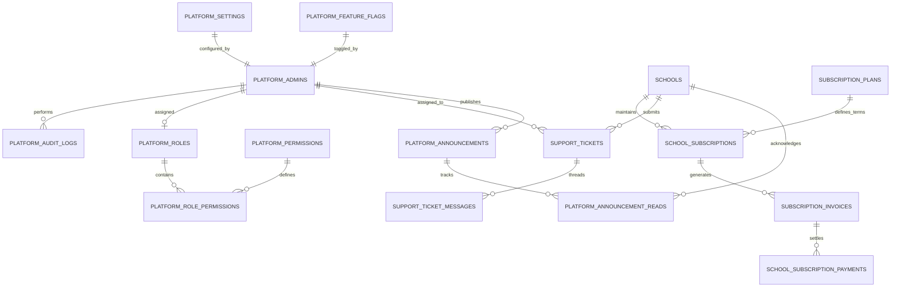

# MyZkool Master Admin — Database Architecture & Schema Design

> **Document Version**: 1.0.0  
> **Classification**: Database Schema Specification  
> **Database Engine**: Supabase PostgreSQL 15  
> **Design Rules**: Non-destructive, idempotent migrations, integer paise financial precision, strict relational referential integrity.

---

## 1. Entity-Relationship Overview



---

## 2. Table Reuse vs New Entity Strategy

To preserve existing functionality and prevent database duplication:

| Table Category | Table Name | Status | Strategy & Integration |
| :--- | :--- | :--- | :--- |
| **Existing School ERP** | `schools` | **REUSE** | Preserved as canonical tenant root. Master Admin reads across all schools and updates status/notes. |
| **Existing User Directory**| `profiles` | **REUSE** | Preserved for School Admins, teachers, accountants, and staff. |
| **Existing Plans** | `subscription_plans` | **REUSE** | Preserved as canonical plan catalog. Master Admin manages pricing, quotas, and feature lists. |
| **Existing Subscriptions**| `school_subscriptions` | **REUSE** | Preserved as active tenant subscription state. Master Admin manages lifecycle, grace periods, and tier changes. |
| **Existing Payments** | `school_subscription_payments`| **REUSE** | Preserved as Razorpay transaction ledger. Linked to new `subscription_invoices`. |
| **New Platform Identity** | `platform_admins` | **NEW** | Decoupled identity for Master Admins, separating SaaS operators from school users. |
| **New Platform RBAC** | `platform_roles` | **NEW** | Predefined and custom platform administrative roles (`super_admin`, `support`, `billing`, `auditor`). |
| **New Permissions** | `platform_permissions` | **NEW** | Granular action privileges (`schools.view`, `schools.suspend`, `plans.edit`, `billing.refund`). |
| **New RBAC Junction** | `platform_role_permissions` | **NEW** | Many-to-many mapping between platform roles and platform permissions. |
| **New Invoicing** | `subscription_invoices` | **NEW** | Official SaaS GST invoices with sequential invoice numbers, tax breakdown, and PDF generation data. |
| **New Support Hub** | `support_tickets` | **NEW** | Centralized helpdesk tickets submitted by schools or initiated by support agents. |
| **New Ticket Thread** | `support_ticket_messages` | **NEW** | Conversation history for support tickets, supporting internal agent notes vs public school replies. |
| **New Communications** | `platform_announcements` | **NEW** | Global broadcast system targeting all schools or specific subscription tiers. |
| **New Read Tracking** | `platform_announcement_reads` | **NEW** | Tracks which schools/administrators have viewed and dismissed announcements. |
| **New Audit Trail** | `platform_audit_logs` | **NEW** | Tamper-evident, immutable event log of all Master Admin actions. |
| **New Configuration** | `platform_settings` | **NEW** | Key-value store for global platform runtime parameters, branding, and integration credentials. |
| **New Feature Flags** | `platform_feature_flags` | **NEW** | Staged rollout flags governing module access across the SaaS platform. |

---

## 3. Detailed Data DDL & Schema Specifications

### 3.1 Platform Identity & Access Control (RBAC)

#### Table: `public.platform_admins`
Dedicated identity record for SaaS platform operators, linked to Supabase Auth (`auth.users`).
```sql
CREATE TABLE IF NOT EXISTS public.platform_admins (
  id UUID PRIMARY KEY DEFAULT gen_random_uuid(),
  auth_id UUID NOT NULL UNIQUE REFERENCES auth.users(id) ON DELETE CASCADE,
  email TEXT NOT NULL UNIQUE,
  full_name TEXT NOT NULL,
  phone TEXT,
  avatar_url TEXT,
  role_id UUID NOT NULL REFERENCES public.platform_roles(id) ON DELETE RESTRICT,
  is_active BOOLEAN NOT NULL DEFAULT true,
  last_login_at TIMESTAMPTZ,
  last_login_ip TEXT,
  created_at TIMESTAMPTZ NOT NULL DEFAULT now(),
  updated_at TIMESTAMPTZ NOT NULL DEFAULT now()
);

CREATE INDEX IF NOT EXISTS idx_platform_admins_auth ON public.platform_admins(auth_id);
CREATE INDEX IF NOT EXISTS idx_platform_admins_role ON public.platform_admins(role_id);
CREATE INDEX IF NOT EXISTS idx_platform_admins_active ON public.platform_admins(is_active);
```

#### Table: `public.platform_roles`
Defines operational roles available within the platform control plane.
```sql
CREATE TABLE IF NOT EXISTS public.platform_roles (
  id UUID PRIMARY KEY DEFAULT gen_random_uuid(),
  slug TEXT NOT NULL UNIQUE, -- 'super_admin', 'support_agent', 'billing_manager', 'auditor'
  name TEXT NOT NULL,
  description TEXT NOT NULL,
  is_system BOOLEAN NOT NULL DEFAULT false, -- Prevents accidental deletion of core roles
  created_at TIMESTAMPTZ NOT NULL DEFAULT now(),
  updated_at TIMESTAMPTZ NOT NULL DEFAULT now()
);

CREATE UNIQUE INDEX IF NOT EXISTS idx_platform_roles_slug ON public.platform_roles(slug);
```

#### Table: `public.platform_permissions`
Atomic operational privileges governing control plane APIs and screens.
```sql
CREATE TABLE IF NOT EXISTS public.platform_permissions (
  id UUID PRIMARY KEY DEFAULT gen_random_uuid(),
  code TEXT NOT NULL UNIQUE, -- e.g. 'schools.view', 'schools.suspend', 'billing.manage'
  module TEXT NOT NULL,      -- 'schools', 'subscriptions', 'billing', 'support', 'security'
  description TEXT NOT NULL,
  created_at TIMESTAMPTZ NOT NULL DEFAULT now()
);

CREATE UNIQUE INDEX IF NOT EXISTS idx_platform_permissions_code ON public.platform_permissions(code);
CREATE INDEX IF NOT EXISTS idx_platform_permissions_module ON public.platform_permissions(module);
```

#### Table: `public.platform_role_permissions`
Associates platform roles with granted permission codes.
```sql
CREATE TABLE IF NOT EXISTS public.platform_role_permissions (
  role_id UUID NOT NULL REFERENCES public.platform_roles(id) ON DELETE CASCADE,
  permission_id UUID NOT NULL REFERENCES public.platform_permissions(id) ON DELETE CASCADE,
  created_at TIMESTAMPTZ NOT NULL DEFAULT now(),
  PRIMARY KEY (role_id, permission_id)
);
```

---

### 3.2 Platform Billing & Invoicing

#### Table: `public.subscription_invoices`
Formal GST tax invoices generated for school SaaS subscriptions.
```sql
CREATE TABLE IF NOT EXISTS public.subscription_invoices (
  id UUID PRIMARY KEY DEFAULT gen_random_uuid(),
  invoice_number TEXT NOT NULL UNIQUE, -- Formatted: 'MZK-INV-2026-0001'
  school_id UUID NOT NULL REFERENCES public.schools(id) ON DELETE CASCADE,
  subscription_id UUID REFERENCES public.school_subscriptions(id) ON DELETE SET NULL,
  plan_slug TEXT NOT NULL,
  billing_cycle TEXT NOT NULL CHECK (billing_cycle IN ('monthly', 'six_months', 'yearly')),
  
  -- Financial precision in integer paise (bigint)
  subtotal_paise BIGINT NOT NULL CHECK (subtotal_paise >= 0),
  discount_paise BIGINT NOT NULL DEFAULT 0 CHECK (discount_paise >= 0),
  taxable_paise BIGINT NOT NULL CHECK (taxable_paise >= 0),
  gst_rate NUMERIC(5, 2) NOT NULL DEFAULT 18.00,
  cgst_paise BIGINT NOT NULL DEFAULT 0,
  sgst_paise BIGINT NOT NULL DEFAULT 0,
  igst_paise BIGINT NOT NULL DEFAULT 0,
  total_paise BIGINT NOT NULL CHECK (total_paise >= 0),
  
  currency TEXT NOT NULL DEFAULT 'INR',
  status TEXT NOT NULL DEFAULT 'unpaid' CHECK (status IN ('draft', 'unpaid', 'paid', 'void', 'refunded')),
  due_date DATE NOT NULL,
  paid_at TIMESTAMPTZ,
  payment_method TEXT CHECK (payment_method IN ('upi', 'card', 'netbanking', 'neft_rtgs', 'manual_cheque', 'trial')),
  payment_id UUID REFERENCES public.school_subscription_payments(id) ON DELETE SET NULL,
  
  -- Customer & statutory billing snapshot (immutable for tax audits)
  billing_school_name TEXT NOT NULL,
  billing_address TEXT NOT NULL,
  billing_state TEXT NOT NULL,
  billing_gstin TEXT,
  hsn_sac_code TEXT NOT NULL DEFAULT '998314', -- IT Software SaaS Service
  pdf_url TEXT,
  metadata JSONB NOT NULL DEFAULT '{}'::jsonb,
  created_at TIMESTAMPTZ NOT NULL DEFAULT now(),
  updated_at TIMESTAMPTZ NOT NULL DEFAULT now()
);

CREATE INDEX IF NOT EXISTS idx_sub_invoices_school ON public.subscription_invoices(school_id);
CREATE INDEX IF NOT EXISTS idx_sub_invoices_status ON public.subscription_invoices(status);
CREATE INDEX IF NOT EXISTS idx_sub_invoices_created ON public.subscription_invoices(created_at DESC);
```

---

### 3.3 Support Center & Helpdesk

#### Table: `public.support_tickets`
School issues, feature suggestions, and inquiries.
```sql
CREATE TABLE IF NOT EXISTS public.support_tickets (
  id UUID PRIMARY KEY DEFAULT gen_random_uuid(),
  ticket_number TEXT NOT NULL UNIQUE, -- e.g. '#T-4821'
  school_id UUID NOT NULL REFERENCES public.schools(id) ON DELETE CASCADE,
  creator_user_id UUID REFERENCES auth.users(id) ON DELETE SET NULL,
  creator_name TEXT NOT NULL,
  creator_email TEXT NOT NULL,
  creator_phone TEXT,
  
  subject TEXT NOT NULL,
  category TEXT NOT NULL CHECK (category IN ('fees', 'students', 'transport', 'website', 'login', 'billing', 'other')),
  priority TEXT NOT NULL DEFAULT 'medium' CHECK (priority IN ('low', 'medium', 'high', 'urgent')),
  status TEXT NOT NULL DEFAULT 'open' CHECK (status IN ('open', 'in_progress', 'waiting_school', 'resolved', 'closed')),
  
  assigned_to UUID REFERENCES public.platform_admins(id) ON DELETE SET NULL,
  first_response_at TIMESTAMPTZ,
  resolved_at TIMESTAMPTZ,
  resolution_summary TEXT,
  metadata JSONB NOT NULL DEFAULT '{}'::jsonb,
  created_at TIMESTAMPTZ NOT NULL DEFAULT now(),
  updated_at TIMESTAMPTZ NOT NULL DEFAULT now()
);

CREATE INDEX IF NOT EXISTS idx_support_tickets_school ON public.support_tickets(school_id);
CREATE INDEX IF NOT EXISTS idx_support_tickets_status ON public.support_tickets(status);
CREATE INDEX IF NOT EXISTS idx_support_tickets_priority ON public.support_tickets(priority);
CREATE INDEX IF NOT EXISTS idx_support_tickets_assigned ON public.support_tickets(assigned_to);
```

#### Table: `public.support_ticket_messages`
Conversation thread records for support tickets.
```sql
CREATE TABLE IF NOT EXISTS public.support_ticket_messages (
  id UUID PRIMARY KEY DEFAULT gen_random_uuid(),
  ticket_id UUID NOT NULL REFERENCES public.support_tickets(id) ON DELETE CASCADE,
  sender_type TEXT NOT NULL CHECK (sender_type IN ('school_user', 'platform_admin', 'system')),
  sender_id UUID NOT NULL,
  sender_name TEXT NOT NULL,
  message TEXT NOT NULL,
  is_internal_note BOOLEAN NOT NULL DEFAULT false, -- True for staff-only notes hidden from school users
  attachments JSONB NOT NULL DEFAULT '[]'::jsonb,
  created_at TIMESTAMPTZ NOT NULL DEFAULT now()
);

CREATE INDEX IF NOT EXISTS idx_support_messages_ticket ON public.support_ticket_messages(ticket_id, created_at ASC);
```

---

### 3.4 Platform Communication & Announcements

#### Table: `public.platform_announcements`
Broadcast messages displayed across schools.
```sql
CREATE TABLE IF NOT EXISTS public.platform_announcements (
  id UUID PRIMARY KEY DEFAULT gen_random_uuid(),
  title TEXT NOT NULL,
  content TEXT NOT NULL,
  announcement_type TEXT NOT NULL DEFAULT 'general' CHECK (announcement_type IN ('general', 'maintenance', 'feature_release', 'billing_notice', 'urgent_alert')),
  target_audience TEXT NOT NULL DEFAULT 'all' CHECK (target_audience IN ('all', 'pro_plan', 'basic_plan', 'trial_only', 'specific_schools')),
  target_school_ids UUID[] DEFAULT '{}',
  is_dismissible BOOLEAN NOT NULL DEFAULT true,
  display_banner BOOLEAN NOT NULL DEFAULT true,
  starts_at TIMESTAMPTZ NOT NULL DEFAULT now(),
  expires_at TIMESTAMPTZ,
  created_by UUID REFERENCES public.platform_admins(id) ON DELETE SET NULL,
  created_at TIMESTAMPTZ NOT NULL DEFAULT now(),
  updated_at TIMESTAMPTZ NOT NULL DEFAULT now()
);

CREATE INDEX IF NOT EXISTS idx_platform_announcements_active ON public.platform_announcements(starts_at, expires_at);
```

#### Table: `public.platform_announcement_reads`
Records tenant dismissal or reading of announcements.
```sql
CREATE TABLE IF NOT EXISTS public.platform_announcement_reads (
  announcement_id UUID NOT NULL REFERENCES public.platform_announcements(id) ON DELETE CASCADE,
  school_id UUID NOT NULL REFERENCES public.schools(id) ON DELETE CASCADE,
  user_id UUID NOT NULL REFERENCES auth.users(id) ON DELETE CASCADE,
  read_at TIMESTAMPTZ NOT NULL DEFAULT now(),
  dismissed_at TIMESTAMPTZ,
  PRIMARY KEY (announcement_id, school_id, user_id)
);
```

---

### 3.5 Security, Governance & Audit Logging

#### Table: `public.platform_audit_logs`
Immutable record of all control plane activities.
```sql
CREATE TABLE IF NOT EXISTS public.platform_audit_logs (
  id UUID PRIMARY KEY DEFAULT gen_random_uuid(),
  admin_id UUID REFERENCES public.platform_admins(id) ON DELETE SET NULL,
  admin_email TEXT NOT NULL,
  action TEXT NOT NULL,           -- e.g. 'school.suspend', 'plan.update', 'user.create', 'ticket.assign'
  resource_type TEXT NOT NULL,    -- 'schools', 'subscription_plans', 'support_tickets', 'platform_settings'
  resource_id TEXT,               -- Target entity identifier
  school_id UUID REFERENCES public.schools(id) ON DELETE SET NULL,
  details JSONB NOT NULL DEFAULT '{}'::jsonb, -- Diff or parameters
  ip_address TEXT,
  user_agent TEXT,
  created_at TIMESTAMPTZ NOT NULL DEFAULT now()
);

CREATE INDEX IF NOT EXISTS idx_platform_audit_created ON public.platform_audit_logs(created_at DESC);
CREATE INDEX IF NOT EXISTS idx_platform_audit_admin ON public.platform_audit_logs(admin_id);
CREATE INDEX IF NOT EXISTS idx_platform_audit_action ON public.platform_audit_logs(action);
CREATE INDEX IF NOT EXISTS idx_platform_audit_school ON public.platform_audit_logs(school_id);
```

---

### 3.6 Global Settings & Feature Flags

#### Table: `public.platform_settings`
Global configuration parameters.
```sql
CREATE TABLE IF NOT EXISTS public.platform_settings (
  key TEXT PRIMARY KEY,
  value JSONB NOT NULL,
  description TEXT NOT NULL,
  is_secret BOOLEAN NOT NULL DEFAULT false, -- If true, value is masked in UI
  updated_by UUID REFERENCES public.platform_admins(id) ON DELETE SET NULL,
  updated_at TIMESTAMPTZ NOT NULL DEFAULT now()
);
```

#### Table: `public.platform_feature_flags`
Global and phased feature switches.
```sql
CREATE TABLE IF NOT EXISTS public.platform_feature_flags (
  key TEXT PRIMARY KEY,            -- e.g. 'ai_document_scanner', 'transport_tracking', 'whatsapp_broadcast'
  name TEXT NOT NULL,
  description TEXT NOT NULL,
  is_enabled_globally BOOLEAN NOT NULL DEFAULT false,
  enabled_school_ids UUID[] DEFAULT '{}',
  target_plans TEXT[] DEFAULT '{}', -- e.g. ['pro', 'custom']
  updated_by UUID REFERENCES public.platform_admins(id) ON DELETE SET NULL,
  updated_at TIMESTAMPTZ NOT NULL DEFAULT now()
);
```

---

## 4. Row Level Security (RLS) Architecture for Platform Tables

1. **Deny-by-default**: RLS is enabled on all platform tables.
2. **Platform Admin Policy**: Only authenticated users whose `auth.uid()` resolves to an active record in `public.platform_admins` can read or write platform tables.
3. **Helper Function (SECURITY DEFINER)**:
```sql
CREATE OR REPLACE FUNCTION public.is_platform_admin()
RETURNS BOOLEAN
SECURITY DEFINER
SET search_path = public
LANGUAGE sql
STABLE
AS $$
  SELECT EXISTS (
    SELECT 1 FROM public.platform_admins
    WHERE auth_id = auth.uid() AND is_active = true
  );
$$;
```
4. **School Exception for Support & Announcements**:
   - `support_tickets`: School Admins can view and insert tickets where `school_id` matches their own tenancy.
   - `support_ticket_messages`: School Admins can view messages on their own tickets where `is_internal_note = false`.
   - `platform_announcements`: Authenticated school users can view announcements targeted to `all` or their plan/school.
