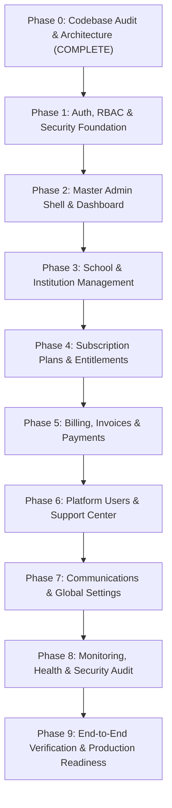

# MyZkool Master Admin — Phased Implementation Roadmap

> **Document Version**: 1.0.0  
> **Methodology**: GSD Protocol (Spec -> Plan -> Execute -> Verify -> Commit)  
> **Execution Strategy**: Sequential Phase-by-Phase Development. Zero regressions to existing School ERP.

---

## 1. Roadmap Overview & Wave Dependencies

---

## 2. Detailed Phase Specifications

### Phase 0: Codebase Audit & Architecture Documentation
* **Status**: **COMPLETED**
* **Deliverables**:
  - `docs/master-admin/CODEBASE_AUDIT.md`: In-depth analysis of existing React 19/Vite/Express/Supabase stack, migrations inventory, and gap identification.
  - `docs/master-admin/ARCHITECTURE.md`: High-level system architecture, dual-plane design, and 10 module definitions.
  - `docs/master-admin/DATABASE_DESIGN.md`: Full schema specifications, table reuse vs new entity mappings, and RLS policies.
  - `docs/master-admin/SECURITY_MODEL.md`: Dual-plane isolation, RBAC matrix, student PII protection, and DPDP compliance.
  - `docs/master-admin/API_DESIGN.md`: Complete Express `/api/master-admin/*` RESTful endpoint specifications.
  - `docs/master-admin/IMPLEMENTATION_PLAN.md`: Sequential phase execution blueprint.

---

### Phase 1: Authentication, RBAC & Security Foundation
* **Objective**: Establish the platform control plane identity, permission model, server middleware, and route guard without touching tenant school admin auth.
* **Tasks**:
  1. **Database Migration**: Create `platform_roles`, `platform_permissions`, `platform_role_permissions`, and `platform_admins` tables with RLS and seed the standard roles (`super_admin`, `support_agent`, `billing_manager`, `auditor`) and permission codes.
  2. **Audit Logging Foundation**: Create `platform_audit_logs` table with append-only RLS and audit logging service function.
  3. **Backend Middleware**: Implement Express middleware `verifyMasterAdminToken` and permission check helper `requirePlatformPermission(...)` in `src/middleware/masterAdminAuth.ts`.
  4. **Master Admin Auth Context / Guard**: Implement `MasterAdminRoute.tsx` in `src/components/master-admin/MasterAdminRoute.tsx` ensuring only verified platform admins can access `/master-admin/*`.
  5. **Verification**: Automated test `tests/test-master-admin-auth-rbac.ts` verifying that school admins cannot access platform APIs and valid platform tokens resolve permissions correctly.

---

### Phase 2: Master Admin Shell & Dashboard
* **Objective**: Build the executive cockpit desktop UI matching the reference design uploaded by the user.
* **Tasks**:
  1. **Shell Layout**: Implement `MasterAdminShell.tsx` with:
     - Collapsible navy sidebar (`#0F172A`) with MyZkool logo, "👑 Super Admin" golden badge, grouped navigation sections (Overview, Platform, Operations, Platform Settings), and user profile footer ("Khaqan Ahmad, Master Administrator").
     - Top bar with global command search (`Ctrl + K`), notification bell, help icon, user avatar pill, and date filter dropdown (`Last 30 Days`).
  2. **Dashboard Metrics Backend API**: Implement `GET /api/master-admin/dashboard/metrics` querying Supabase for:
     - Total Schools count and 30-day registration trend.
     - Total Students aggregate count across all active schools.
     - Total Revenue (MRR) calculated from verified subscription payments.
     - Active Subscriptions count and plan distribution ratios.
  3. **UI Visualizations**:
     - 4 KPI cards (`MetricKpiCard.tsx`) with percentage badges.
     - School Registrations area/line chart.
     - Subscription Revenue 6-month bar chart.
     - Subscription Overview donut chart (Pro, Basic, Custom, Trial).
     - System Health widget with operational indicators (Web App, Database, Storage, Cron, API) and uptime/latency metrics.
     - Quick Actions panel (Add New School, Create Plan, View Payments, Support, Announcement).
     - Recent Activities stream and Pending & Attention alert badges.
  4. **Verification**: TypeScript check + dashboard data integration test.

---

### Phase 3: School & Institution Management
* **Objective**: Full institutional lifecycle management across all schools.
* **Tasks**:
  1. **Backend API**: Endpoints for schools listing with search, filtering by state/board/status, pagination, detail fetch, registration, and status toggle (`active` / `suspended`).
  2. **Schools Directory UI**: Searchable data table with school name, logo, subdomain, board, city, student headcount, active plan, status badge, and action menu.
  3. **School Detail View**: Tabbed inspection screen (Overview, Subscription, Student/Staff Counts, Onboarding Step, Admin Audit History).
  4. **School Registration Modal / Flow**: Quick onboard institution with subdomain availability validation.
  5. **Suspend / Reactivate Dialog**: Confirmation modal with mandatory reason logging to `platform_audit_logs`.
  6. **Verification**: Automated tests for school status updates, subdomain collision guards, and audit trail generation.

---

### Phase 4: Subscription & Entitlement Management
* **Objective**: Complete product tier management, pricing adjustments, and quota enforcement.
* **Tasks**:
  1. **Backend API**: CRUD endpoints for `subscription_plans` and tenant subscription override API (`PATCH /api/master-admin/schools/:id/subscription`).
  2. **Subscription Plans UI**: Interactive cards and comparison matrix for `Basic`, `Pro`, and `Custom` plans showing pricing (Monthly, 6 Months, Yearly), student limits, staff limits, and feature lists.
  3. **Plan Edit Modal**: Live editing of prices, trial periods, and feature entitlements.
  4. **Tenant Subscription Manager**: Ability for platform admins to extend trials, apply discount codes, or grant custom quotas for specific institutions.
  5. **Verification**: Automated test verifying plan pricing updates, student limit updates, and server-side subscription validation.

---

### Phase 5: Billing, Invoicing & Financial Operations
* **Objective**: SaaS revenue accounting, automated GST invoices, and transaction ledger.
* **Tasks**:
  1. **Database Migration**: Create `subscription_invoices` table with sequential invoice numbering (`MZK-INV-YYYY-XXXX`) and financial integrity constraints.
  2. **Backend API**: Endpoints for invoice listing, invoice generation, payment ledger, and refund processing.
  3. **Invoices UI**: Searchable invoice ledger with status filters (`paid`, `unpaid`, `void`), date ranges, and PDF download triggers.
  4. **Invoice Detail & Receipt View**: Formatted GST tax invoice view display with HSN/SAC code (`998314`), CGST/SGST/IGST breakdown, and institutional billing address.
  5. **Payment Transactions View**: Complete Razorpay order reconciliation log.
  6. **Verification**: Financial calculation tests ensuring integer paise precision, tax balancing, and idempotency.

---

### Phase 6: Platform Users & Support Center
* **Objective**: Platform operator management and school helpdesk ticketing.
* **Tasks**:
  1. **Database Migration**: Create `support_tickets` and `support_ticket_messages` tables with RLS allowing school users to submit tickets and platform admins to triage/reply.
  2. **Backend API**: Endpoints for platform admin user provisioning, role assignments, and ticket lifecycle operations.
  3. **User & Access UI**: Master admin team management, role creation, and active session inspection.
  4. **Support Center UI**: Ticket list with priority tags, status filtering, category tabs, and ticket detail conversation view with internal note capability.
  5. **Verification**: Support ticket lifecycle test and internal note privacy test (ensuring school admins cannot see internal notes).

---

### Phase 7: Platform Communications & Global Settings
* **Objective**: Cross-tenant broadcasts and runtime platform configuration.
* **Tasks**:
  1. **Database Migration**: Create `platform_announcements`, `platform_announcement_reads`, `platform_settings`, and `platform_feature_flags` tables.
  2. **Backend API**: Endpoints for announcement dispatch, settings management, and feature flag toggling.
  3. **Announcements UI**: Announcement composer with targeting options (all schools, Pro only, specific schools) and active banner preview.
  4. **Global Settings UI**: Platform branding, payment gateway toggles, WhatsApp configuration, and maintenance mode switch.
  5. **Feature Flags UI**: Staged rollout matrix for platform modules.
  6. **Verification**: Announcement targeting tests and feature flag evaluation tests.

---

### Phase 8: System Monitoring, Health & Security Audit Logs
* **Objective**: Real-time observability and compliance audit exploration.
* **Tasks**:
  1. **Backend Monitoring Service**: Live health probes for Supabase DB, Express server, storage buckets, and cron jobs.
  2. **System Monitoring UI**: Infrastructure status cards, API latency metrics, storage utilization graphs per tenant, and recent error log stream.
  3. **Audit Logs Explorer**: High-density audit event viewer with filters by operator, date range, action type, and JSON payload diff viewer.
  4. **Verification**: Live health endpoint ping test and audit log indexing verification.

---

### Phase 9: End-to-End Verification, QA & Production Build
* **Objective**: Comprehensive regression testing, RLS validation, and production build artifact verification.
* **Tasks**:
  1. **Cross-Tenant Isolation Regression**: Run full existing test suite (`npm test`) ensuring 0 regressions to existing School ERP.
  2. **Master Admin Security Audit Suite**: Test token forging rejection, role escalation prevention, and student PII shielding.
  3. **TypeScript & Lint Validation**: `npm run lint` (`tsc --noEmit`) clean exit.
  4. **Production Build**: `npm run build` validating Vite bundle and Node CJS server bundle (`dist/server.cjs`).
  5. **Verification Report**: Comprehensive summary document detailing tested vectors, performance benchmarks, and deployment guidelines.

---

## 3. Strict Verification & Exit Criteria

Every single phase must fulfill the following verification gates before proceeding:
1. `npm run lint` passes with 0 errors.
2. Relevant automated test script created in `tests/` passes with exit code 0.
3. Database migrations verified to be forward-compatible, non-destructive, and idempotent (`IF NOT EXISTS`).
4. Proof recorded (captured command output or test log).
5. Git commit following the canonical standard: `feat(master-admin): phase N - <description>`.
