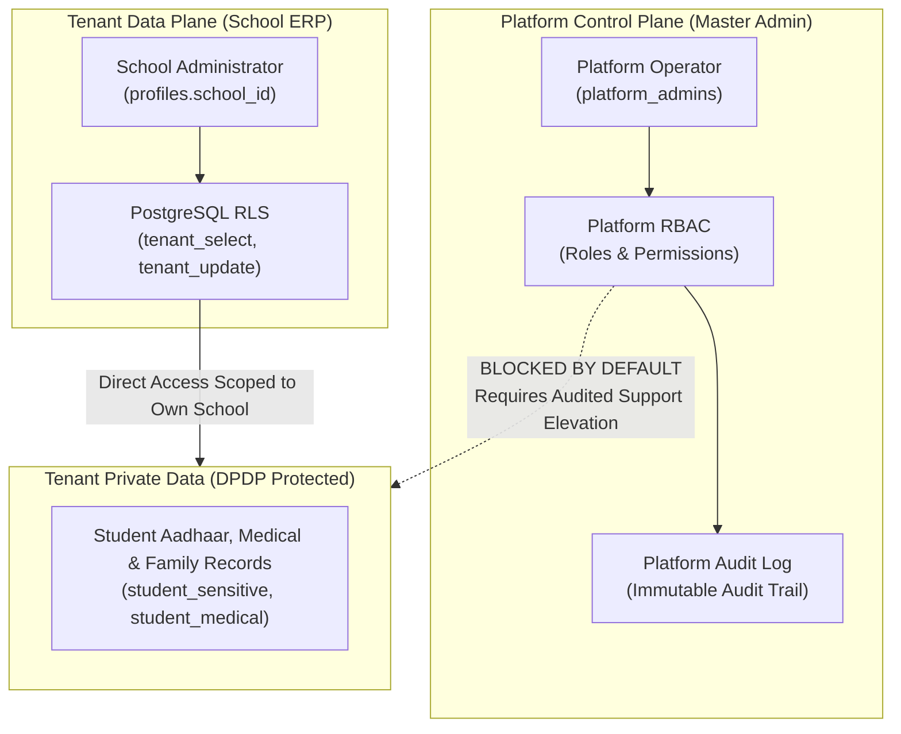
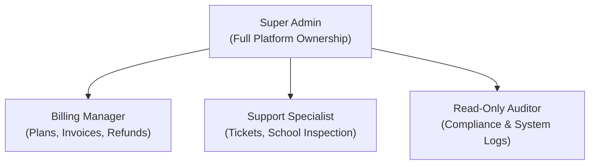
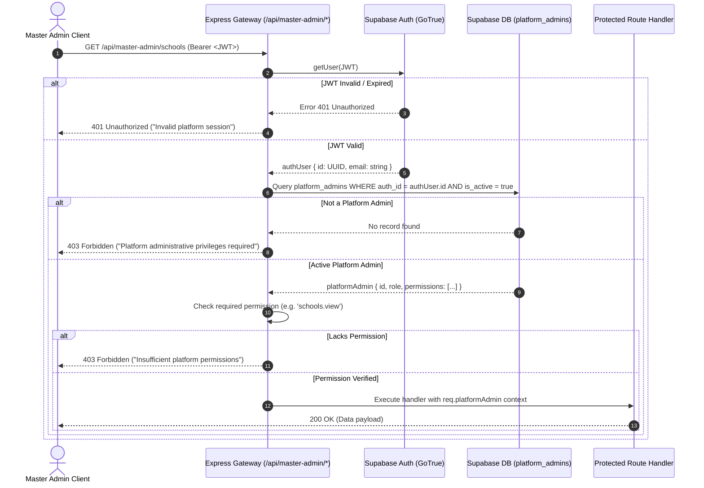

# MyZkool Master Admin — Security & Permission Architecture

> **Document Version**: 1.0.0  
> **Classification**: Security Architecture Specification  
> **Compliance Standard**: Digital Personal Data Protection Act (DPDP Act, 2023)  

---

## 1. Dual-Plane Security Philosophy

MyZkool segregates security controls across two distinct boundaries:
1. **Tenant Data Plane (School ERP)**: Guarantees zero cross-school data leaks. Every query executes within the tenant's bounded context via PostgreSQL Row Level Security (RLS) linked to `school_id`.
2. **Platform Control Plane (Master Admin)**: Oversees platform health, tenancy lifecycles, and billing without granting blanket, uncontrolled access to student personal data.



---

## 2. Threat Modeling & Mitigation Matrix

| Threat Vector | Risk Description | Severity | Architecture Mitigation |
| :--- | :--- | :--- | :--- |
| **Cross-School Tenant Bleed** | A compromised school admin token accesses data belonging to another school. | **CRITICAL** | Strict database RLS enforcing `school_id = get_current_school_id()`, combined with composite foreign keys `(school_id, parent_id)`. |
| **Service Role Key Exposure** | Leaking the Supabase `service_role` secret in frontend JavaScript bundles. | **CRITICAL** | Service role key is restricted exclusively to the backend Node.js environment (`server.ts` process environment). Zero client bundling in Vite. |
| **Student PII Mass Exfiltration** | A rogue platform operator exports Aadhaar numbers, parent contact lists, or medical records. | **CRITICAL** | Platform operators are **denied direct access to student PII tables by default**. School records display anonymized/aggregated metrics (e.g. total student count). |
| **Frontend Role Spoofing** | Attacker modifies client JWT or local state to set `role: "super_admin"`. | **HIGH** | Client state is considered completely untrusted. Express API middleware (`verifyMasterAdminToken`) independently verifies identity and permissions directly in `public.platform_admins`. |
| **Subscription Tampering** | School user injects request parameters to unlock Pro features without paying. | **HIGH** | Feature gating and entitlement limits are enforced server-side. Plan changes occur solely via verified Razorpay webhooks or audited Master Admin transactions. |
| **Financial Record Alteration** | Silent modification of billing invoices or payment status. | **HIGH** | Invoices and payment logs are append-only. Every status change creates an audit entry in `public.platform_audit_logs`. |
| **Administrative Repudiation** | Operator denies performing a destructive action (e.g., school suspension). | **HIGH** | All control plane write actions require authenticated operator ID, recording IP address, timestamp, and JSON parameter payload. |

---

## 3. Platform Role-Based Access Control (RBAC)

Master Admin operations are governed by four predefined platform roles:

### 3.1 Role Hierarchy & Capabilities



| Operational Area | Super Admin | Billing Manager | Support Specialist | Read-Only Auditor |
| :--- | :---: | :---: | :---: | :---: |
| **View Platform Dashboard** | Full | Full | Full | Full |
| **View Schools Directory** | Full | Full | Full | Full |
| **Approve / Suspend School** | Yes | No | No | No |
| **Modify Subscription Plans**| Yes | Yes | No | No |
| **Generate SaaS Invoices** | Yes | Yes | No | No |
| **Process SaaS Refunds** | Yes | Yes | No | No |
| **Manage Support Tickets** | Full | View Only | Full | View Only |
| **Platform Announcements** | Full | No | Draft Only | View Only |
| **Manage Platform Users** | Full | No | No | No |
| **System Health & Config** | Full | No | View Only | View Only |
| **Security & Audit Logs** | Full | View Only | View Only | Full |
| **Tenant Student Data Access**| Denied* | Denied | Denied* | Denied |

*\*Note: In exceptional operational debugging scenarios, temporary student operational inspection requires time-limited support token elevation with an explicit audit justification.*

---

## 4. Platform Permission Catalog

Granular permissions stored in `public.platform_permissions`:

```
schools.view              -> View school directory, profile, and aggregated statistics
schools.create            -> Register a new educational institution
schools.update            -> Modify institutional metadata, contact information
schools.suspend           -> Temporarily or permanently suspend a school's access
schools.support_access    -> Request audited, time-bound proxy access for troubleshooting

subscriptions.view        -> View plan catalog, school active subscriptions
subscriptions.manage      -> Create, modify, or archive subscription tiers and quotas
subscriptions.override    -> Apply custom billing cycles, trials, or quota overrides

billing.view              -> View platform revenue, transactions, and invoice lists
billing.invoice_create    -> Issue custom or enterprise invoices
billing.refund            -> Authorize and process subscription payment refunds

support.view              -> View incoming tickets and queries
support.reply             -> Post public replies and manage ticket statuses
support.internal_note     -> Write internal platform-only coordination notes

announcements.publish     -> Dispatch global or targeted announcements to schools
announcements.delete      -> Archive or withdraw active announcements

users.manage              -> Provision, deactivate, or edit platform administrator accounts
users.roles               -> Assign or alter administrative roles

system.monitoring         -> View real-time service health, cron jobs, and error logs
system.settings           -> Update global platform parameters, secrets, and feature flags

audit.view                -> Inspect platform security and administrative audit trails
```

---

## 5. Server-Side Authentication & API Guard Protocol

Every request hitting `/api/master-admin/*` must pass through the server-side authentication pipeline:



---

## 6. Student PII Protection & DPDP Act Compliance

Under India's Digital Personal Data Protection Act (DPDP Act, 2023), student information (minors' data, parents' contact details, biometric/Aadhaar information) requires stringent safeguards:

1. **Aggregations Over Raw Records**: The Master Admin Dashboard and School Management modules present aggregated statistics (e.g., "Sunrise Public School: 842 Students, 48 Staff"). Raw student lists are not loaded in the platform control plane.
2. **Aadhaar Protection**: The existing `student_sensitive` table uses AES-256-GCM symmetric encryption (`APP_MASTER_KEY`). Clear-text Aadhaar is never accessible to Master Admins.
3. **No Cross-School Impersonation**: Master Admins do not possess a magic "login as principal" backdoor that bypasses RLS. Support troubleshooting occurs via structured APIs or read-only diagnostic exports with active audit logging.
