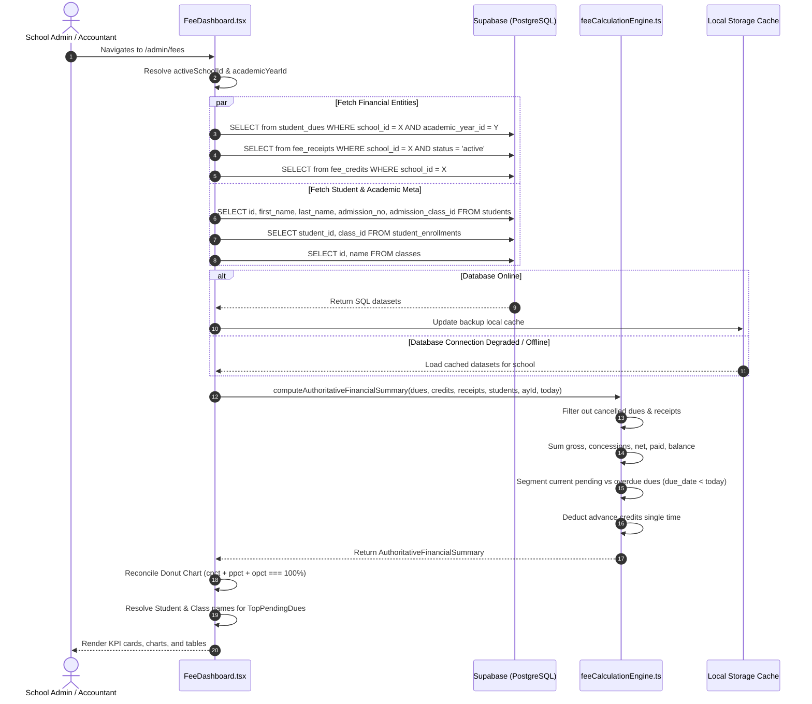
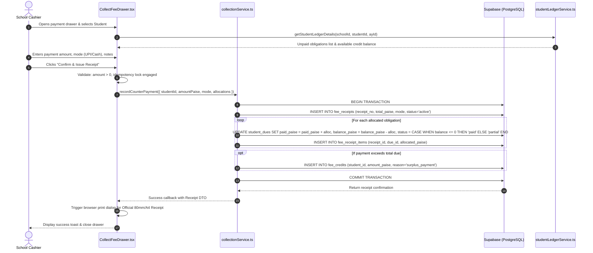
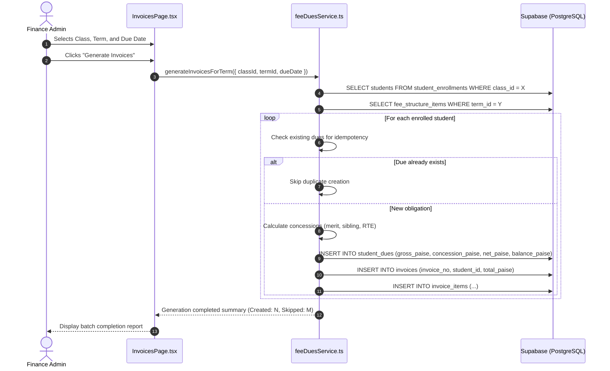
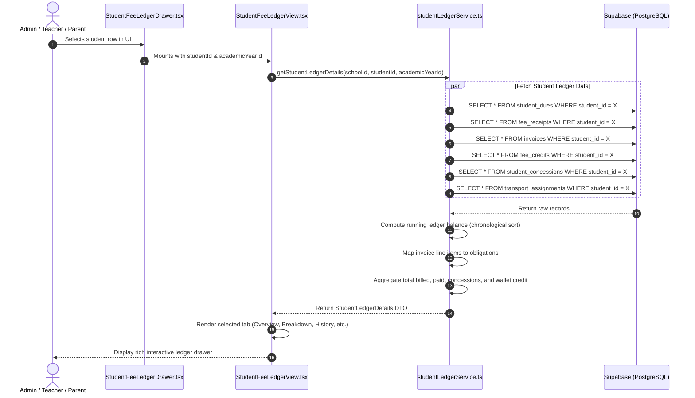

# Fee Management — Data Flow & Sequence Diagrams

## 1. Overview

This document details the lifecycle and transaction flow for financial data across the MyZkool platform. Every financial interaction is strictly scoped to `school_id`, executed in integer paise, and guarded against race conditions and double-entry discrepancies.

---

## 2. Dashboard Loading & Metric Computation Flow

---

## 3. Counter Payment Collection Flow

---

## 4. Invoice Generation Flow

---

## 5. Student Fee Ledger Retrieval Flow

