# Fee Management — Page Architecture & Component Hierarchy

## 1. Overview & Layout Architecture

The Fee Management module is accessed through `/admin/fees` and subroutes under `/admin/fees/*`. It operates inside the shared `AdminShell` layout, providing a uniform navigation header (`FeeNavHeader`) and breadcrumbs across all fee workflows.

### Primary Routes
- `/admin/fees`: Executive Financial Dashboard (`FeeDashboard.tsx`)
- `/admin/fees/structures`: Fee Structure Builder (`FeeStructuresPage.tsx`)
- `/admin/fees/collect`: Counter Payment Collector (`FeeCollectPage.tsx`)
- `/admin/fees/invoices`: Invoices & Billing Operations (`InvoicesPage.tsx`)
- `/admin/fees/dues`: Dues, Defaulters & Reminders (`DuesRemindersPage.tsx`)
- `/admin/fees/reports`: Multi-Dimensional Financial Reports (`FeeReportsPage.tsx`)
- `/admin/fees/heads`: General Ledger Fee Heads (`FeeHeadsPage.tsx`)
- `/admin/fees/terms`: Term Calendars & Installment Schedules (`FeeTermsPage.tsx`)
- `/admin/fees/concessions`: Concession Rules & RTE Waivers (`ConcessionRulesPage.tsx`)
- `/admin/fees/late-fees`: Late Fee Penalty Rules (`LateFeeRulesPage.tsx`)

---

## 2. Component Hierarchy Diagram

```mermaid
graph TD
    AdminShell[AdminShell Layout] --> FeeNavHeader[FeeNavHeader Navigation]
    AdminShell --> FeeDashboard[FeeDashboard Page]
    AdminShell --> InvoicesPage[InvoicesPage: Student Fee Management]
    
    FeeDashboard --> MetricCards[Financial KPI Summary Cards]
    FeeDashboard --> ChartRow[Charts Row: Monthly Trend & Collection Donut]
    FeeDashboard --> QuickActions[Quick Action Bar]
    FeeDashboard --> RecentCollections[Recent Fee Collections Table]
    FeeDashboard --> TopPendingDues[Top Pending Dues Table]
    
    InvoicesPage --> PageHeader[Page Header: Breadcrumbs, Title, Subtitle, Actions]
    InvoicesPage --> InvoicesMetrics[7 Financial KPI Summary Cards]
    InvoicesPage --> InvoicesFilters[Advanced Filters, Search Bar & Quick Status Pills]
    InvoicesPage --> StudentSummariesTable[Student Fee Management Table with Pagination]
    
    InvoicesPage -.->|Pay / Collect| CollectFeeDrawer
    InvoicesPage -.->|View Ledger| StudentFeeLedgerDrawer
    InvoicesPage -.->|Send Reminders| SendRemindersDrawer
    InvoicesPage -.->|Bulk Action| BulkGenerateModal[BulkGenerateModal]
    InvoicesPage -.->|Bulk Action| ImportInvoicesModal[ImportInvoicesModal]
    
    FeeDashboard -.->|Opens drawer| CollectFeeDrawer[CollectFeeDrawer]
    FeeDashboard -.->|Opens drawer| SendRemindersDrawer[SendRemindersDrawer]
    FeeDashboard -.->|Row click| StudentFeeLedgerDrawer[StudentFeeLedgerDrawer Container]
    
    StudentFeeLedgerDrawer --> StudentFeeLedgerView[StudentFeeLedgerView Orchestrator]
    
    StudentFeeLedgerView --> TabHeader[Navigation Tab Bar: 8 Tabs]
    StudentFeeLedgerView --> TabOverview[StudentLedgerOverviewTab]
    StudentFeeLedgerView --> TabBreakdown[StudentLedgerBreakdownTab]
    StudentFeeLedgerView --> TabHistory[StudentLedgerHistoryTab]
    StudentFeeLedgerView --> TabInvoices[StudentLedgerInvoicesTab]
    StudentFeeLedgerView --> TabPayments[StudentLedgerPaymentsTab]
    StudentFeeLedgerView --> TabConcessions[StudentLedgerConcessionsTab]
    StudentFeeLedgerView --> TabTransport[StudentLedgerTransportTab]
    StudentFeeLedgerView --> TabCredits[StudentLedgerCreditsTab]
```

---

## 3. Executive Dashboard Structure (`FeeDashboard.tsx`)

The dashboard is structured into five distinct visual zones:

### Zone 1: Executive Header & Context Controls
- **Page Title**: "Fee Management" with contextual subtitle.
- **Academic Year Selector**: Bound to school's active terms.
- **Primary CTAs**:
  - `+ Create Invoice`: Navigates to `/admin/fees/invoices?action=create`.
  - `Collect Payment`: Opens `CollectFeeDrawer` with student search.
  - `More Actions`: Dropdown menu linking to Dues, Fee Structures, and Day Close Register.

### Zone 2: Authoritative Financial KPI Cards
Four metric cards driven strictly by `computeAuthoritativeFinancialSummary`:
1. **Total Fee Collected**: Active collected revenue in INR (`total_collected_paise`). Subtitle indicates active receipts count.
2. **Total Outstanding Dues**: Canonical unpaid balance (`net_outstanding_paise`). Subtitle breaks down current versus overdue amounts (`current + overdue`).
3. **Overdue Dues**: Strict subset of outstanding dues past due date (`overdue_dues_paise`). Clearly tagged as `(Subset of Outstanding)`.
4. **Advance Credits Balance**: Unallocated wallet credits held on behalf of students (`advance_credits_paise`). Subtitle shows students with positive credit balances.

### Zone 3: Collection Analytics & Trends
- **Monthly Collection Trend (Area Chart)**: 6-month historical trajectory of realized collections versus billings.
- **Collection Status Breakdown (Donut Chart)**: Reconciled 3-part distribution:
  - Collected % (`cpct`)
  - Pending (Current) % (`ppct`)
  - Overdue % (`opct`)
  - Guaranteed invariant: `cpct + ppct + opct === 100%`.

### Zone 4: Fast Navigation & Action Shortcuts
Card grid providing one-click access to:
- **Generate Fee Invoices**: Bulk generation by class/section.
- **Record Counter Payment**: Fast cashier collection drawer.
- **Manage Fee Structure**: Fee head allocations and term rules.
- **Send Fee Reminders**: WhatsApp/SMS template dispatch.

### Zone 5: Real-Time Operational Tables
- **Recent Fee Collections**: Real-time log of the latest 5 successful receipts. Displays Receipt No, Student Name, Class, Amount, Payment Method, and Status badge.
- **Top Pending Dues**: Deterministically sorted list (highest balance first) of top 5 defaulters. Displays Student Avatar/Name, Admission No, Enrolled Class, Balance, and Overdue Age. Clicking any row opens the `StudentFeeLedgerDrawer`.

---

## 4. Student Fee Ledger Drawer Architecture

The Student Fee Ledger is designed as a standalone, zero-loss accounting view rendered inside an off-canvas drawer (`StudentFeeLedgerDrawer.tsx`).

### State & Lifecycle
- Activated via custom event or prop: `setSelectedStudentId(id)`.
- Fetches authoritative data via `studentLedgerService.getStudentLedgerDetails(schoolId, studentId, academicYearId)`.
- Renders `StudentFeeLedgerView.tsx` with lazy-evaluated tab selection.

### 8-Tab Tabular Breakdown
1. **Overview (`StudentLedgerOverviewTab`)**:
   - Student portrait, admission number, roll number, class/section, guardian name & phone.
   - Financial scorecard: Net Assessed, Total Paid, Concessions, Closing Balance, Available Credit.
   - Quick action: "Collect Payment" targeting this student directly.
2. **Fee Breakdown (`StudentLedgerBreakdownTab`)**:
   - Line-by-line schedule of every assessed fee obligation.
   - Columns: Fee Head, Term / Period, Due Date, Gross, Concession, Net, Paid, Balance, Status.
3. **Ledger Journal (`StudentLedgerHistoryTab`)**:
   - Double-entry chronological history of all debit (assessments) and credit (payments, credit notes) events.
   - Displays running balance after every transaction.
4. **Invoices (`StudentLedgerInvoicesTab`)**:
   - All issued invoices with invoice numbers, issue dates, line items, and settlement status.
   - Action to download/print official PDF tax invoices.
5. **Payments (`StudentLedgerPaymentsTab`)**:
   - Complete receipt history. Displays receipt number, date, payment mode (Cash, UPI, Cheque, Net Banking), transaction ID, and cashier name.
   - Action to view or print official fee receipt.
6. **Concessions & Waivers (`StudentLedgerConcessionsTab`)**:
   - Audit trail of all approved discounts, sibling waivers, staff concessions, and RTE subsidies.
7. **Transport Fees (`StudentLedgerTransportTab`)**:
   - Route name, stop location, pickup/drop schedule, and associated monthly/quarterly transport charges.
8. **Advance Credits (`StudentLedgerCreditsTab`)**:
   - Log of surplus payments converted into student wallet credits, with allocation records against subsequent dues.
