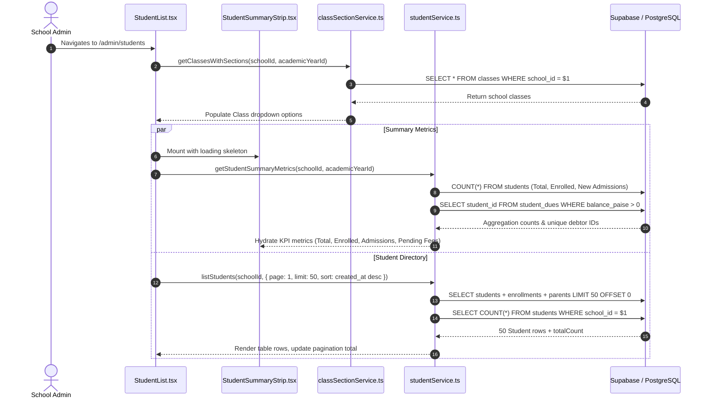
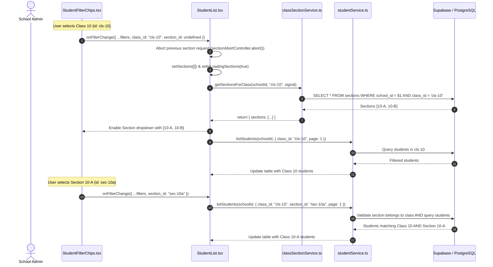
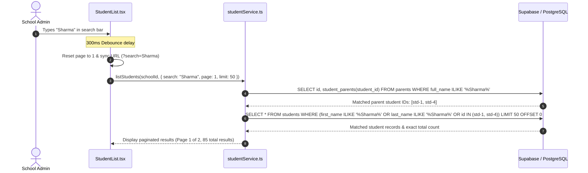
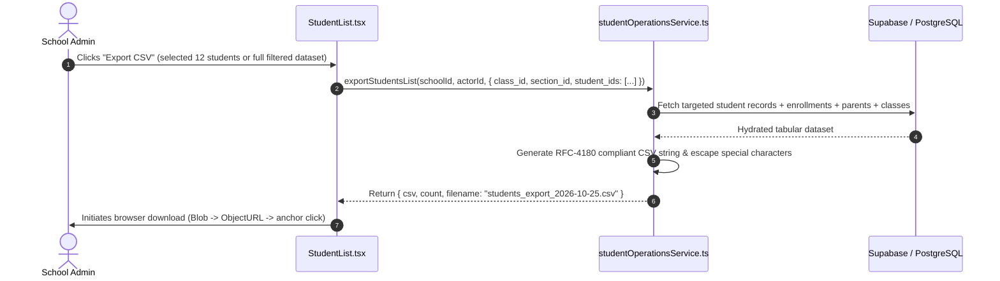

# Students Module: End-to-End Data Flow

## 1. Data Flow Overview

Data in the Students module flows through strict, unidirectional pipelines ensuring full multi-tenant isolation, caching resilience, and audit compliance.

```
[User Action in UI]
       ↓
[React Component / Hook Event Handler]
       ↓
[Service Layer (studentService / classSectionService / studentOperationsService)]
       ↓
[Authorization Guard (Role Perms & Tenant Isolation Scoping)]
       ↓
[Supabase Client (Parameterized Query / RPC / RLS Filtering)]
       ↓
[PostgreSQL Database (Multi-tenant Tables & Canonical Views)]
       ↓
[Response Sanitization & Type Hydration]
       ↓
[Component State Update & React Re-render]
```

---

## 2. Sequence Diagrams

### 2.1 Initial Page Load



### 2.2 Class Selection Followed by Section Selection



### 2.3 Search and Server-Side Pagination



### 2.4 Student Export Flow


