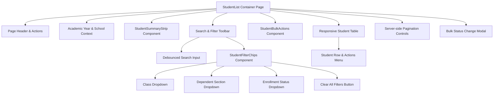

# Students Module: Page Structure and UI Architecture

## 1. Page Layout & Component Hierarchy

The Students Management page (`/admin/students`) is structured into distinct, modular functional zones designed for clarity, high responsiveness, and zero layout shift.

---

## 2. Component Responsibilities & Boundaries

### 2.1 `StudentList` Container ([`src/pages/admin/students/StudentList.tsx`](file:///c:/Users/yadav/Desktop/MyZkool/src/pages/admin/students/StudentList.tsx))
- **Primary Responsibility**: Master state coordinator and data orchestrator.
- **Owned State**:
  - `filters`: Current active filters (`class_id`, `section_id`, `status`, `has_dues`, `is_new_admission`).
  - `searchQuery`: Debounced search string (300ms debounce).
  - `pagination`: Current server-side page (`page`), items per page (`pageSize = 50`), and deterministic sorting (`sort_by`, `sort_order`).
  - `students`: Current loaded page of `StudentListItem[]`.
  - `totalCount` & `totalPages`: Server-authoritative dataset size.
  - `selectedStudentIds`: `Set<string>` of selected student IDs across the active page.
  - `isUpdatingStatus` & `isExporting`: Mutation and download indicators.
- **URL Synchronization**: Synchronizes `search`, `class_id`, `section_id`, `status`, and `has_dues` with browser URL query parameters (`useSearchParams`).

### 2.2 `StudentSummaryStrip` ([`src/pages/admin/students/StudentSummaryStrip.tsx`](file:///c:/Users/yadav/Desktop/MyZkool/src/pages/admin/students/StudentSummaryStrip.tsx))
- **Primary Responsibility**: Renders top KPI metric cards with loading skeletons and error recovery.
- **Metric Cards**:
  1. **Total Students**: Total non-deleted student count for the school.
  2. **Active Enrolled**: Students with enrollment status `'enrolled'`.
  3. **New Admissions**: Students admitted in active academic year or flagged as new.
  4. **Pending Fees**: Unique students with balance dues (`balance_paise > 0`) in `student_dues`.
- **States**: Skeleton placeholders during data fetching, error banner with a manual Retry button, and clickable filter triggers.

### 2.3 `StudentFilterChips` ([`src/pages/admin/students/StudentFilterChips.tsx`](file:///c:/Users/yadav/Desktop/MyZkool/src/pages/admin/students/StudentFilterChips.tsx))
- **Primary Responsibility**: Dependent Class → Section filtering and status selectors.
- **Strict Hierarchy Rules**:
  - When `class_id` is empty: Section dropdown is `disabled`, renders neutral text `"Select a class first"`, and holds 0 options.
  - When `class_id` is selected: Loads exclusively sections assigned to that class; enables dropdown.
  - When `class_id` is changed or cleared: Section selection is immediately cleared (`section_id: undefined`) and options reset.
  - "Clear filters" button only displays when non-default filters are active.

### 2.4 `StudentBulkActions` ([`src/pages/admin/students/StudentBulkActions.tsx`](file:///c:/Users/yadav/Desktop/MyZkool/src/pages/admin/students/StudentBulkActions.tsx))
- **Primary Responsibility**: Bulk selection management bar and action dispatch.
- **Capabilities**:
  - Displays selected record count (`X students selected`).
  - "Change Status" action triggering modal dialog with mandatory audit reason.
  - Direct navigation to Bulk Promotion, ID Card generation, and Transport Assignment.
  - "Select All" / "Deselect All" toggling.

---

## 3. Student Table Columns & Row Actions

| Column | Alignment | Rendering Details |
| :--- | :--- | :--- |
| **Checkbox** | Center | Row selection toggle. Does not trigger row-click navigation. |
| **Student** | Left | Avatar/initials, full name (`first_name`, `last_name`), and admission identifier. |
| **Admission / SR** | Left | Formatted Admission Number and State SR Number. |
| **Class & Section** | Left | Badged Class Name and Section (e.g. `Class 10 - A`). |
| **Roll No** | Center | Roll number if assigned in active enrollment. |
| **Primary Guardian** | Left | Parent name, relation, and phone number with WhatsApp quick-dial button. |
| **Enrollment Status** | Center | Color-coded status badge (`enrolled`, `inactive`, `transferred`, `withdrawn`, `passed_out`). |
| **Actions** | Right | Action menu: View Details, Edit Profile, Collect Fees, Manage Transport, Delete. |

---

## 4. Accessibility & Responsive Design

- **Semantic Elements**: Built using semantic `<table>`, `<thead>`, `<tbody>`, `<th scope="col">`, and `<nav aria-label="Pagination">`.
- **Screen Reader Support**: All icon-only buttons include descriptive `aria-label` attributes (e.g., `aria-label="Filter by class"`).
- **Keyboard Navigation**: Form inputs, select dropdowns, and pagination controls have visible focus rings (`focus:ring-2 focus:ring-emerald-500`).
- **Responsive Overflow**: Table is housed inside an `overflow-x-auto` wrapper with sticky headers (`sticky top-0 bg-white shadow-sm`), guaranteeing no horizontal page blowout on mobile screens (viewport < 768px).
